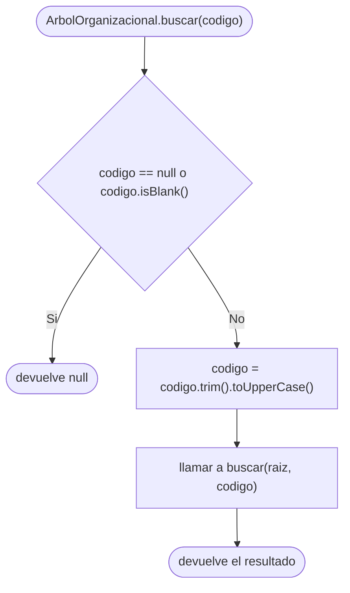
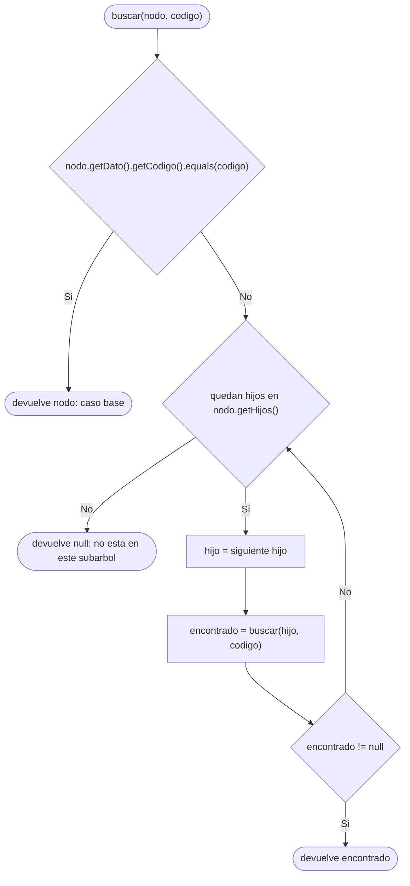
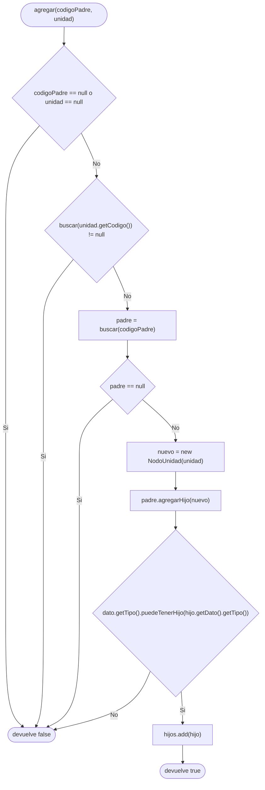

# Diagramas de flujo: agregar y buscar (arbol general)

> **Responsable:** Damian · **Rama:** `Damian_Cunalata`
>
> **Para que:** mostrar las decisiones de buscar (recursivo) y de agregar (codigo unico, padre y jerarquia).

Un diagrama de flujo recorre las decisiones de un metodo, de la entrada hasta el valor que devuelve. Cada diagrama sigue el codigo de `src/negocio/ArbolOrganizacional.java`: las mismas condiciones y los mismos resultados.

Convencion de formas (igual que el Grupo 1): inicio y fin en rectangulo redondeado, proceso en rectangulo, decision en rombo, error en rectangulo rojo. La llamada recursiva es un paso explicito, no un ciclo de regreso al inicio. En estos metodos no hay rectangulos rojos porque `agregar` y `buscar` no lanzan excepciones: devuelven `false` o `null`.

## Indice

| Metodo | Clase | Capa | Archivo fuente |
|---|---|---|---|
| [buscar(codigo)](#buscar) | `ArbolOrganizacional` | negocio | `src/negocio/ArbolOrganizacional.java` |
| [buscar(nodo, codigo)](#buscarNodo) | `ArbolOrganizacional` | negocio | `src/negocio/ArbolOrganizacional.java` |
| [agregar(codigoPadre, unidad)](#agregar) | `ArbolOrganizacional` | negocio | `src/negocio/ArbolOrganizacional.java` |

## Capa negocio, clase ArbolOrganizacional

### Metodo buscar(codigo)
Paquete principal: SJA-UTA | Capa: negocio | Paquete: negocio | Clase: ArbolOrganizacional | Archivo: src/negocio/ArbolOrganizacional.java

Firma: `public NodoUnidad buscar(String codigo)`

El metodo publico solo valida y normaliza. Si el codigo es null o esta en blanco devuelve `null` sin recorrer el arbol. Si no, lo pasa a mayusculas, porque `UnidadAcademica` guarda los codigos asi. El metodo publico delega en `private NodoUnidad buscar(NodoUnidad nodo, String codigo)` empezando desde la raiz.

Ejemplo: `buscar("sw-n3-b")` busca `"SW-N3-B"` desde la raiz `UTA`.

### Metodo buscar(nodo, codigo)
Paquete principal: SJA-UTA | Capa: negocio | Paquete: negocio | Clase: ArbolOrganizacional | Archivo: src/negocio/ArbolOrganizacional.java

Firma: `private NodoUnidad buscar(NodoUnidad nodo, String codigo)`

Cada llamada pregunta si el nodo actual es el buscado; si coincide, ese es el **caso base** y lo devuelve. Si no, recorre sus hijos uno por uno y se llama a si misma con cada hijo (**caso recursivo**). Apenas un hijo lo encuentra, devuelve ese nodo hacia arriba; si ningun hijo lo tiene, devuelve `null` y la llamada anterior sigue con el siguiente hermano. En el peor caso revisa los 88 nodos: O(n).

Ejemplo: para `SW-N3-B` el camino es UTA, FISEI, SW, SW-N3, SW-N3-A (devuelve `null`) y SW-N3-B (coincide).

### Metodo agregar(codigoPadre, unidad)
Paquete principal: SJA-UTA | Capa: negocio | Paquete: negocio | Clase: ArbolOrganizacional | Archivo: src/negocio/ArbolOrganizacional.java

Firma: `public boolean agregar(String codigoPadre, UnidadAcademica unidad)`

`agregar` hace tres revisiones antes de tocar el arbol: que no haya datos null, que el codigo no exista en ninguna parte del arbol (usa el mismo `buscar` recursivo) y que el padre exista. Si todo pasa, crea el nodo y llama a `agregarHijo` del Grupo 1, que decide con `puedeTenerHijo` si la jerarquia es valida y, si lo es, hace `hijos.add(hijo)`. Cada tipo solo acepta el siguiente: UNIVERSIDAD > FACULTAD > CARRERA > NIVEL > PARALELO; no se puede saltar un nivel y un PARALELO no acepta hijos. La rama de datos null no se alcanza desde el menu, porque un codigo vacio o un tipo invalido hacen que `UnidadAcademica` lance `IllegalArgumentException` antes. Complejidad O(n) por las busquedas.

Ejemplo: `SW-N3-C` bajo `SW-N3` (un NIVEL puede tener PARALELO) devuelve `true` y el menu imprime `[Agregar unidad] Unidad agregada`. Si se repite, o si se intenta poner la facultad `FX` bajo la carrera `SW`, devuelve `false` y se imprime `[Agregar unidad] No se pudo agregar`. Las 88 unidades de `DatosPrueba.cargar` se crean con este mismo metodo.
