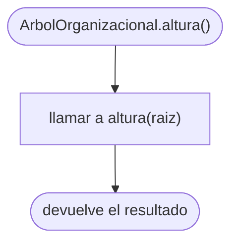
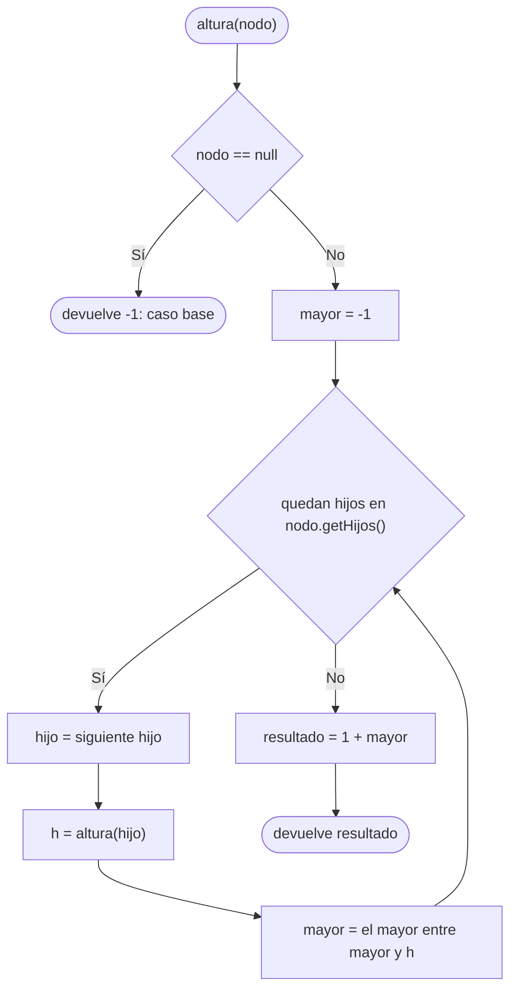

# Diagramas de flujo: altura (árbol general)

> **Responsable:** Kenneth · **Rama:** `Mateo-Chalco`
>
> **Para qué:** mostrar cómo altura calcula la altura del árbol general de forma recursiva: 1 + la mayor altura de los hijos, y una hoja vale 0.

Un diagrama de flujo recorre las decisiones de un método, de la entrada hasta el valor que devuelve. Cada diagrama sigue el código de `src/negocio/ArbolOrganizacional.java`: las mismas condiciones y los mismos resultados.

Convención de formas (igual que el Grupo 1): inicio y fin en rectángulo redondeado, proceso en rectángulo, decisión en rombo, error en rectángulo rojo. La llamada recursiva es un paso explícito, no un ciclo de regreso al inicio. En estos métodos no hay rectángulos rojos porque `altura` no lanza excepciones.

## Índice

| Método | Clase | Capa | Archivo fuente |
|---|---|---|---|
| [altura()](#altura) | `ArbolOrganizacional` | negocio | `src/negocio/ArbolOrganizacional.java` |
| [altura(nodo)](#alturaNodo) | `ArbolOrganizacional` | negocio | `src/negocio/ArbolOrganizacional.java` |

## Capa negocio, clase ArbolOrganizacional

### Método altura()
Paquete principal: SJA-UTA | Capa: negocio | Paquete: negocio | Clase: ArbolOrganizacional | Archivo: src/negocio/ArbolOrganizacional.java

Firma: `public int altura()`

El método público no tiene lógica propia: empieza el cálculo desde la raíz (`UTA`) y devuelve lo que calcule el método privado `altura(NodoUnidad nodo)`. Lo usa la opción 4 del menú.

### Método altura(nodo)
Paquete principal: SJA-UTA | Capa: negocio | Paquete: negocio | Clase: ArbolOrganizacional | Archivo: src/negocio/ArbolOrganizacional.java

Firma: `private int altura(NodoUnidad nodo)`

Cada llamada empieza con `mayor = -1` y va quedándose con la altura más grande entre sus hijos; para calcular la de cada hijo se llama a sí misma (**caso recursivo**). Al final devuelve `1 + mayor`. Una hoja no tiene hijos, así que devuelve `1 + (-1) = 0`, y por eso la altura se cuenta en aristas. El caso base `nodo == null` solo se alcanza con un árbol vacío y devuelve -1. Se visita cada nodo una sola vez: O(n).

Ejemplo: el camino más largo de los datos de prueba es UTA, FISEI, SW, SW-N3, SW-N3-A: 4 aristas, así que la opción 4 muestra `Altura: 4`.
