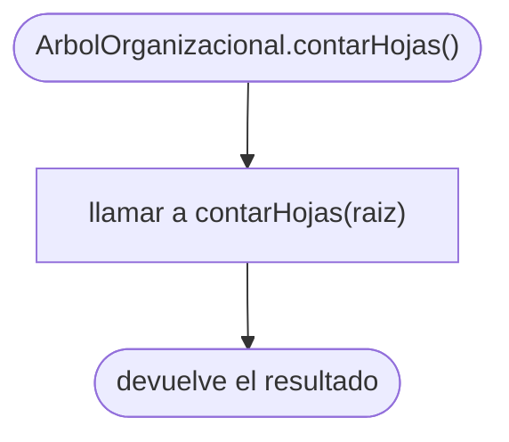
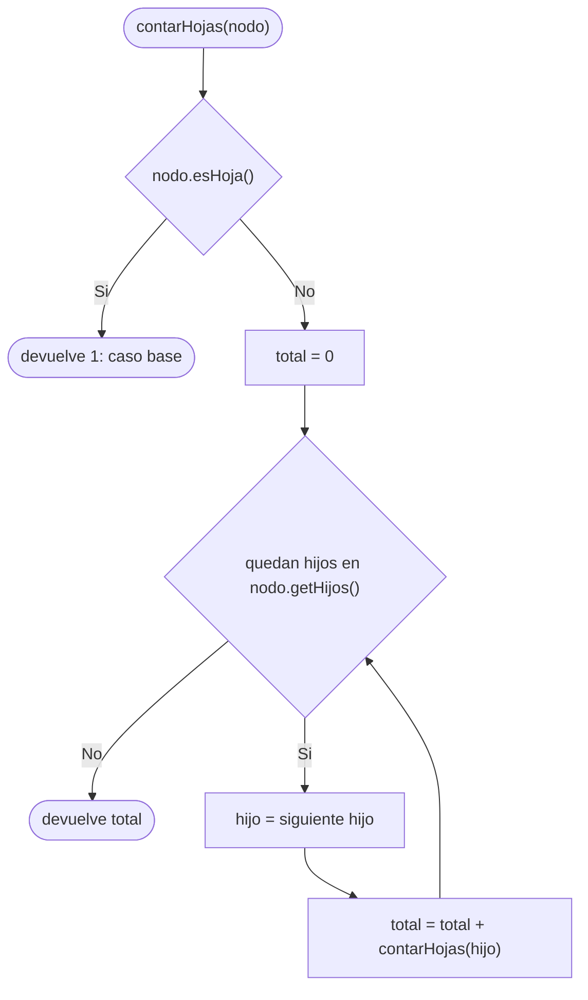

# Diagramas de flujo: contarHojas (árbol general)

> **Responsable:** Monica · **Rama:** `Sara-Tacuri`
>
> **Para qué:** mostrar la recursión de contarHojas: el caso base en la hoja y la suma de las hojas de cada hijo.

Un diagrama de flujo recorre las decisiones de un método, de la entrada hasta el valor que devuelve. Cada diagrama sigue el código de `src/negocio/ArbolOrganizacional.java`: las mismas condiciones y los mismos resultados.

Convención de formas (igual que el Grupo 1): inicio y fin en rectángulo redondeado, proceso en rectángulo, decisión en rombo, error en rectángulo rojo. La llamada recursiva es un paso explícito, no un ciclo de regreso al inicio. En estos métodos no hay rectángulos rojos porque `contarHojas` no lanza excepciones: siempre devuelve un número.

## Índice

| Método | Clase | Capa | Archivo fuente |
|---|---|---|---|
| [contarHojas()](#contarHojas) | `ArbolOrganizacional` | negocio | `src/negocio/ArbolOrganizacional.java` |
| [contarHojas(nodo)](#contarHojasNodo) | `ArbolOrganizacional` | negocio | `src/negocio/ArbolOrganizacional.java` |

## Capa negocio, clase ArbolOrganizacional

### Método contarHojas()
Paquete principal: SJA-UTA | Capa: negocio | Paquete: negocio | Clase: ArbolOrganizacional | Archivo: src/negocio/ArbolOrganizacional.java

Firma: `public int contarHojas()`

El método público no valida nada, porque la raíz nunca es `null`: el constructor siempre la crea. Solo delega en `private int contarHojas(NodoUnidad nodo)` empezando desde la raíz.

Ejemplo: con los datos de prueba, `contarHojas()` empieza en `UTA` y la opción 4 del menú imprime `Hojas: 57`.

### Método contarHojas(nodo)
Paquete principal: SJA-UTA | Capa: negocio | Paquete: negocio | Clase: ArbolOrganizacional | Archivo: src/negocio/ArbolOrganizacional.java

Firma: `private int contarHojas(NodoUnidad nodo)`

Cada llamada pregunta si el nodo es una hoja (`esHoja()` de `NodoUnidad` es verdadero cuando `hijos.isEmpty()`); si lo es, ese es el **caso base** y devuelve 1. Si no, el nodo no cuenta por sí mismo: recorre sus hijos uno por uno, se llama a sí misma con cada hijo (**caso recursivo**) y suma lo que devuelven. A diferencia de `buscar`, no puede parar antes, porque necesita revisar todos los hijos: siempre pasa por los 88 nodos, O(n).

Ejemplo: para un PARALELO como `SW-N3-B` (grado 0) la llamada devuelve 1 enseguida. Para `UTA`, que tiene 10 hijos, devuelve la suma de las hojas de sus 10 subárboles, que con los datos de prueba da 57.