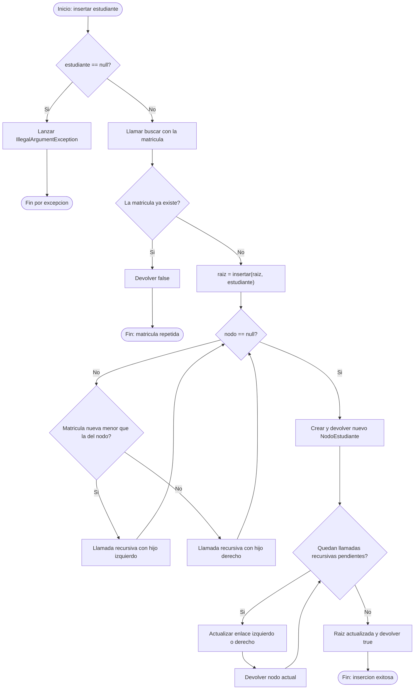
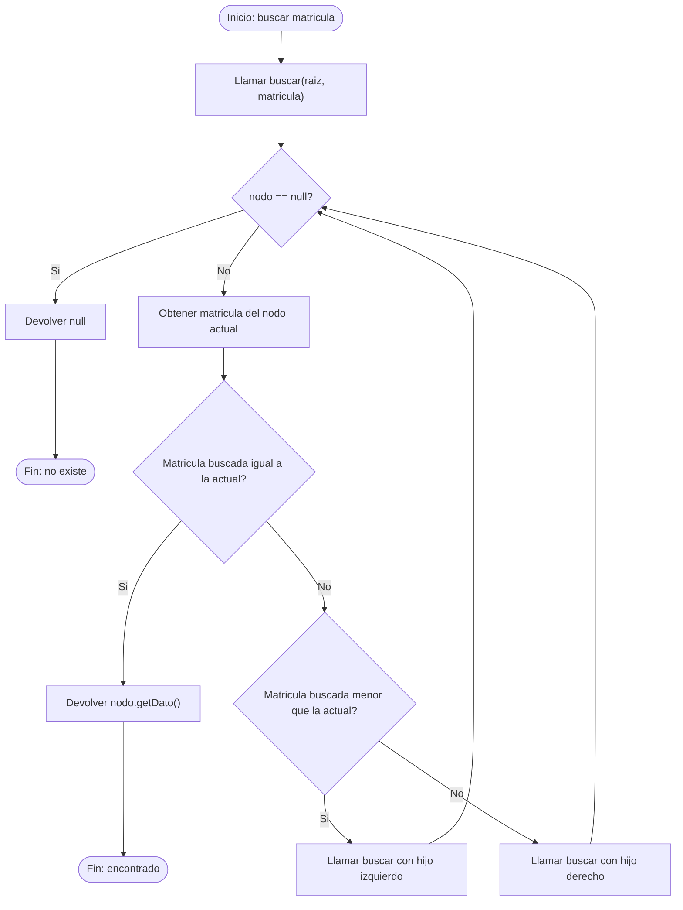

# Diagramas de flujo: insertar y buscar (ABB)

**Responsable:** Kenneth  
**Rama:** `Mateo-Chalco`  
**Clase:** `ArbolEstudiantes.java`  
**Proyecto:** SJA-UTA - Grupo 2

## 1. Diagrama de flujo: insertar (B1)

**Metodo:** `insertar(Estudiante estudiante)`

El algoritmo inserta un estudiante en el arbol binario de busqueda mediante llamadas recursivas, evitando matriculas repetidas.

### Explicacion

El metodo recibe un objeto `Estudiante` y verifica que no sea `null`. Si es nulo, lanza una excepcion.

Luego comprueba si la matricula ya existe mediante el metodo `buscar`. Si existe, devuelve `false` para evitar duplicados.

Cuando la matricula no existe, comienza la insercion recursiva desde la raiz. Si la matricula nueva es menor que la del nodo actual, desciende por la izquierda; de lo contrario, por la derecha.

El caso base ocurre cuando `nodo == null`. En ese momento se crea un nuevo `NodoEstudiante`. Las llamadas recursivas retornan actualizando los enlaces correspondientes hasta recuperar la raiz.

Las flechas que regresan a la condicion `nodo == null` representan nuevas llamadas recursivas, no un ciclo `while`.

**Ejemplo de insercion:**

Paralelo: `SW-N3-B`

Matricula nueva: `45`

Camino: `50 -> 30 -> 40 -> null`

Resultado: el estudiante 45 queda como hijo derecho del nodo 40.

**Complejidad temporal:** O(h), con peor caso O(n).

---

## 2. Diagrama de flujo: buscar (B2)

**Metodo:** `buscar(int matricula)`

El algoritmo busca un estudiante mediante su matricula, recorriendo recursivamente el subarbol correspondiente.

### Explicacion

El metodo publico `buscar(int matricula)` inicia la busqueda desde la raiz del ABB.

El metodo privado recursivo comprueba primero si el nodo actual es `null`. Si lo es, devuelve `null`, indicando que el estudiante no existe.

Si el nodo contiene la matricula buscada, devuelve el objeto `Estudiante`.

Si no coincide, compara la matricula buscada con la del nodo actual. Cuando es menor, continua por el subarbol izquierdo; cuando es mayor, por el derecho.

Las llamadas recursivas terminan cuando se encuentra el estudiante o se llega a un nodo `null`.

**Ejemplo de busqueda:**

Paralelo: `SW-N3-B`

Matricula buscada: `99`

Camino: `50 -> 70 -> 80 -> null`

Resultado: `null`, porque la matricula 99 no existe.

**Complejidad temporal:** O(h), con peor caso O(n).

---

## 3. Casos de prueba

| Operacion | Entrada | Resultado esperado |
|---|---|---|
| Insertar | Matricula 45 | true |
| Insertar repetida | Matricula 45 nuevamente | false |
| Insertar nulo | estudiante = null | IllegalArgumentException |
| Buscar existente | Matricula 45 | Estudiante encontrado |
| Buscar inexistente | Matricula 99 | null |
| Buscar en arbol vacio | Matricula 99 | null |

## 4. Conclusion

Los metodos `insertar` y `buscar` utilizan recursividad para procesar los nodos de un arbol binario de busqueda.

La insercion mantiene el orden de las matriculas, impide duplicados y actualiza los enlaces entre nodos.

La busqueda compara las matriculas para recorrer unicamente el camino necesario.

Ambos metodos tienen complejidad temporal O(h), donde h es la altura del arbol. En un ABB equilibrado, la complejidad es O(log n), mientras que en un arbol degenerado puede alcanzar O(n).
