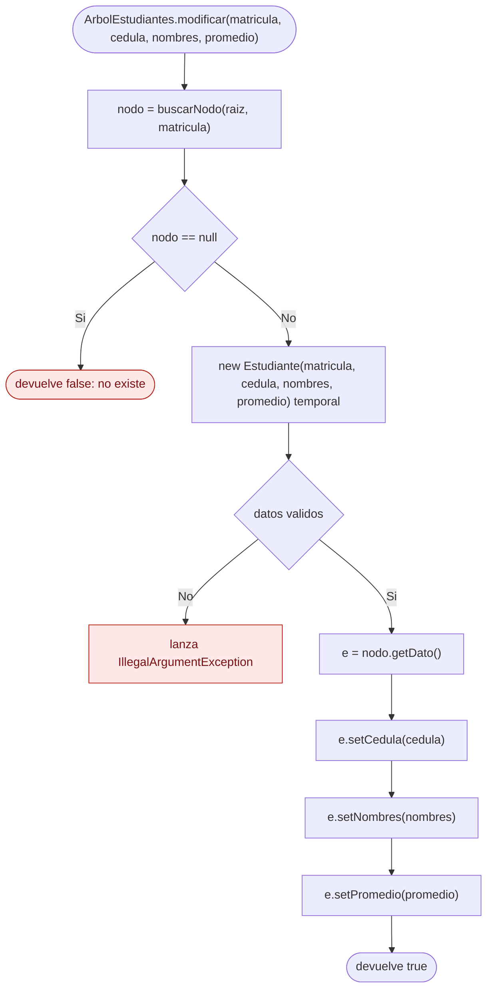
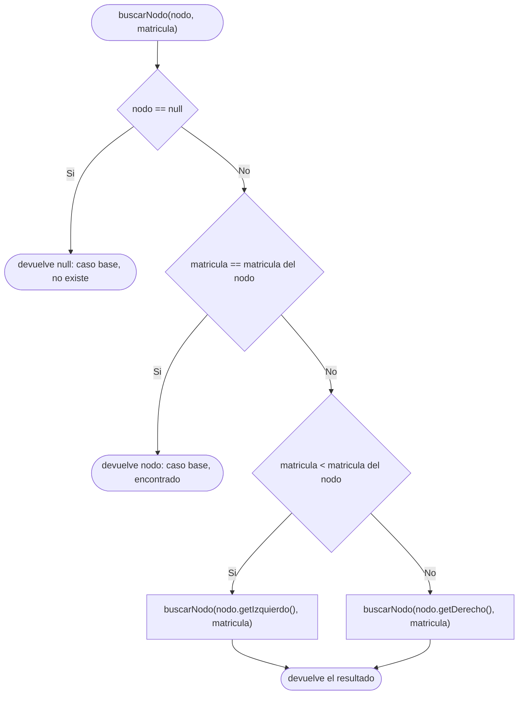
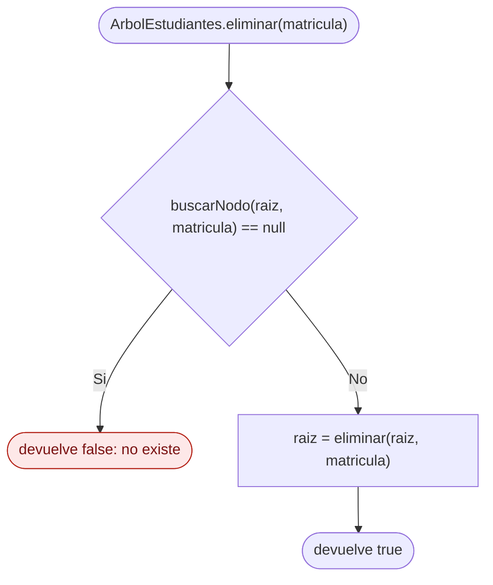
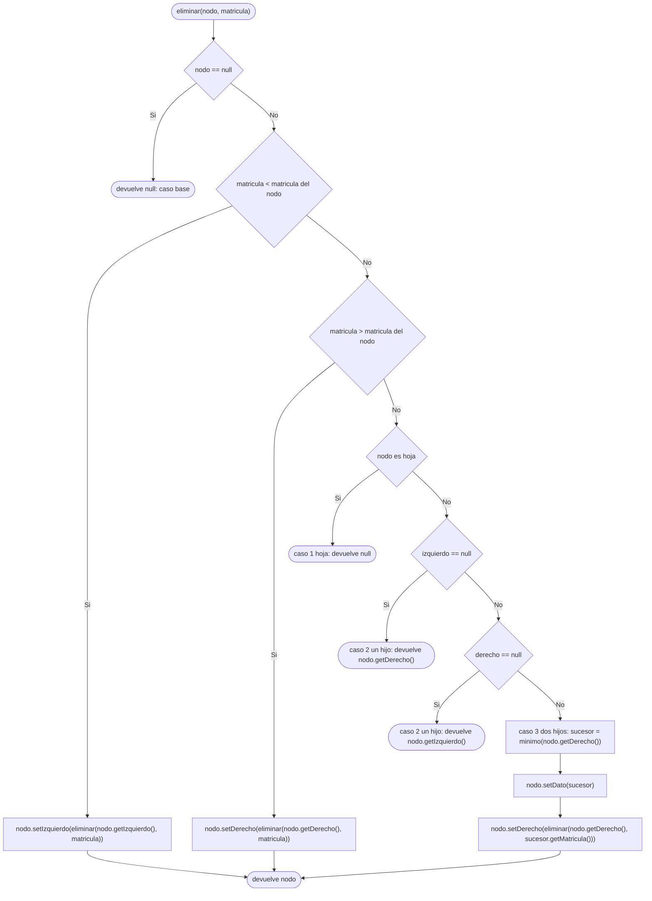
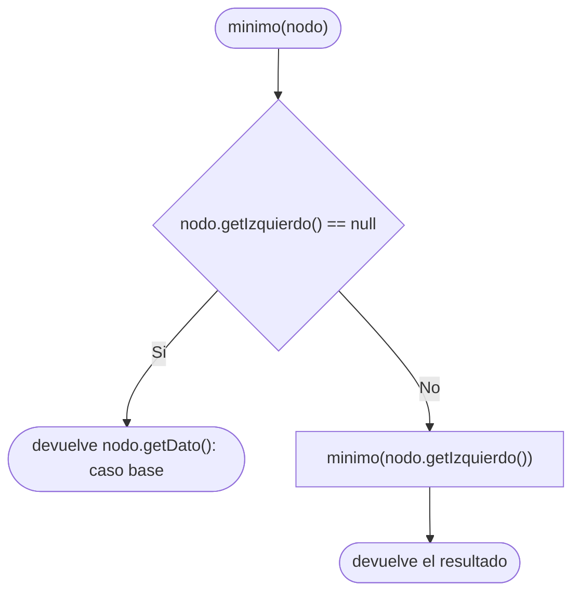

# Diagramas de flujo: modificar y eliminar (ABB de estudiantes)

> **Responsable:** Luis · **Rama:** `Rama-Luis-Silva`
>
> **Para que:** mostrar las decisiones de modificar (validar y luego cambiar) y de eliminar (hoja, un hijo y dos hijos).

Un diagrama de flujo recorre las decisiones de un metodo, de la entrada hasta el valor que devuelve. Cada diagrama sigue el codigo de `src/negocio/ArbolEstudiantes.java`: las mismas condiciones y los mismos resultados.

Convencion de formas (igual que el Grupo 1): inicio y fin en rectangulo redondeado, proceso en rectangulo, decision en rombo, error en rectangulo rojo. La llamada recursiva es un paso explicito, no un ciclo de regreso al inicio. En `modificar` el rectangulo rojo es la excepcion de validacion y los casos de "no existe" que devuelven `false`.

## Indice

| Metodo | Clase | Capa | Archivo fuente |
|---|---|---|---|
| [modificar(matricula, cedula, nombres, promedio)](#modificar) | `ArbolEstudiantes` | negocio | `src/negocio/ArbolEstudiantes.java` |
| [buscarNodo(nodo, matricula)](#buscarNodo) | `ArbolEstudiantes` | negocio | `src/negocio/ArbolEstudiantes.java` |
| [eliminar(matricula)](#eliminar) | `ArbolEstudiantes` | negocio | `src/negocio/ArbolEstudiantes.java` |
| [eliminar(nodo, matricula)](#eliminarNodo) | `ArbolEstudiantes` | negocio | `src/negocio/ArbolEstudiantes.java` |
| [minimo(nodo)](#minimo) | `ArbolEstudiantes` | negocio | `src/negocio/ArbolEstudiantes.java` |

## Capa negocio, clase ArbolEstudiantes

### Metodo modificar(matricula, cedula, nombres, promedio)
Paquete principal: SJA-UTA | Capa: negocio | Paquete: negocio | Clase: ArbolEstudiantes | Archivo: src/negocio/ArbolEstudiantes.java

Firma: `public boolean modificar(int matricula, String cedula, String nombres, double promedio)`

El metodo busca el nodo con `buscarNodo`. Si no existe, devuelve `false` sin tocar nada. Si existe, primero valida todos los datos creando un `Estudiante` temporal: si algun dato es invalido, la excepcion se lanza antes de cambiar el estudiante real. Solo despues aplica `setCedula`, `setNombres` y `setPromedio` sobre el estudiante del nodo. La matricula nunca se cambia porque es la clave de orden del arbol. Complejidad O(h), peor caso O(n).

Ejemplo: en `SW-N3-B`, `modificar(45, "1800000045", "Estudiante Nuevo", 9.5)` encuentra el nodo por `50 -> 30 -> 40 -> 45` y devuelve `true`. Con cedula `123` lanza la excepcion de validacion y con matricula `99` devuelve `false`.

### Metodo buscarNodo(nodo, matricula)
Paquete principal: SJA-UTA | Capa: negocio | Paquete: negocio | Clase: ArbolEstudiantes | Archivo: src/negocio/ArbolEstudiantes.java

Firma: `private NodoEstudiante buscarNodo(NodoEstudiante nodo, int matricula)`

Es la busqueda propia de `modificar` y `eliminar`, para no depender del codigo de Kenneth. Tiene dos casos base: nodo `null` (no existe) y matricula igual (encontrado). En el caso recursivo baja por la izquierda si la matricula es menor y por la derecha si es mayor. Complejidad O(h).

Ejemplo: `buscarNodo(raiz, 45)` recorre 50, 30, 40 y 45. Para `99` recorre 50, 70, 80 y llega a `null`.

### Metodo eliminar(matricula)
Paquete principal: SJA-UTA | Capa: negocio | Paquete: negocio | Clase: ArbolEstudiantes | Archivo: src/negocio/ArbolEstudiantes.java

Firma: `public boolean eliminar(int matricula)`

El metodo publico solo comprueba que la matricula exista. Si no existe, devuelve `false` y el arbol queda igual. Si existe, delega en `private NodoEstudiante eliminar(NodoEstudiante nodo, int matricula)` empezando desde la raiz y guarda en `raiz` el nodo que devuelve, porque la raiz misma puede cambiar.

### Metodo eliminar(nodo, matricula)
Paquete principal: SJA-UTA | Capa: negocio | Paquete: negocio | Clase: ArbolEstudiantes | Archivo: src/negocio/ArbolEstudiantes.java

Firma: `private NodoEstudiante eliminar(NodoEstudiante nodo, int matricula)`

Cada llamada devuelve el nodo que debe quedar enlazado en ese lugar. Si el nodo es `null` es el **caso base**. Si la matricula es menor o mayor, es el **caso recursivo**: baja por la izquierda o la derecha y reengancha el resultado con `setIzquierdo` o `setDerecho`. Al encontrar el nodo se aplican tres casos: hoja (devuelve `null`), un hijo (devuelve ese hijo) y dos hijos (copia el sucesor inorden con `setDato` y lo elimina del subarbol derecho, donde sera hoja o tendra un solo hijo). Complejidad O(h), peor caso O(n).

Ejemplo: en `SW-N3-B` con el 45 insertado, `eliminar(20)` es hoja y se reemplaza por `null`. `eliminar(60)` tiene solo a 65, que sube a su lugar. `eliminar(50)` tiene dos hijos y lo reemplaza 65. El recorrido INORDEN queda `30 35 40 45 65 70 80` y la raiz es 65.

### Metodo minimo(nodo)
Paquete principal: SJA-UTA | Capa: negocio | Paquete: negocio | Clase: ArbolEstudiantes | Archivo: src/negocio/ArbolEstudiantes.java

Firma: `private Estudiante minimo(NodoEstudiante nodo)`

Busca el menor de un subarbol: si el nodo no tiene hijo izquierdo, ese es el menor (**caso base**); si lo tiene, se llama a si mismo con el hijo izquierdo (**caso recursivo**). `eliminar` lo usa para obtener el sucesor inorden. Complejidad O(h).

Ejemplo: `minimo` del subarbol derecho de 50 (raiz 70) baja de 70 a 60, luego de 60 no tiene izquierdo y devuelve 60. Con el 60 ya eliminado, el subarbol derecho es 70 con 65 y 80, y devuelve 65.
