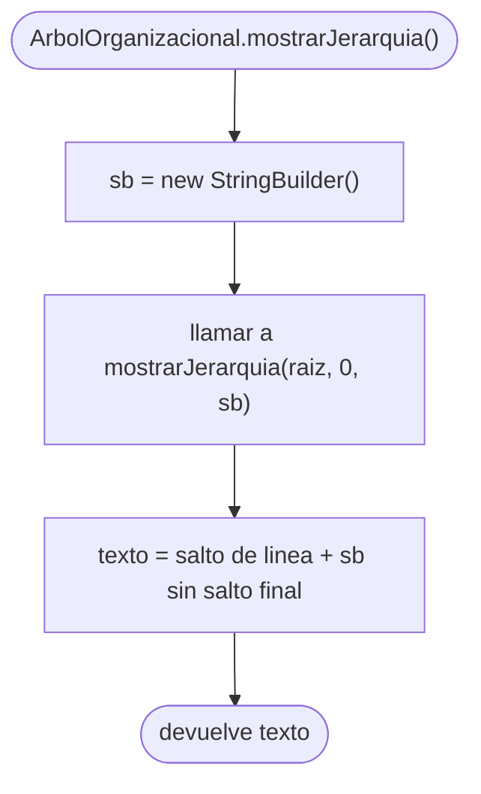
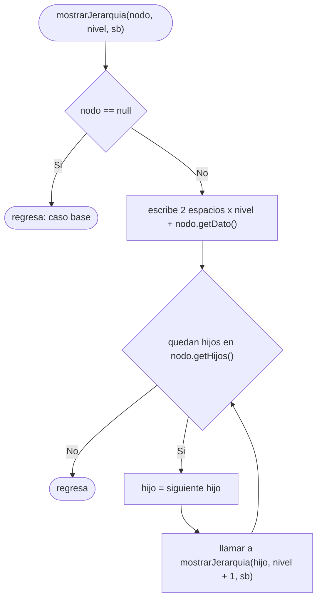

# Diagramas de flujo: mostrarJerarquia (arbol general)

> **Responsable:** Darwin · **Rama:** `Rama-Joel`
>
> **Para que:** mostrar como mostrarJerarquia recorre el arbol general en preorden y escribe cada unidad con 2 espacios de sangria por nivel.

Un diagrama de flujo recorre las decisiones de un metodo, de la entrada hasta el valor que devuelve. Cada diagrama sigue el codigo de `src/negocio/ArbolOrganizacional.java`: las mismas condiciones y los mismos resultados.

Convencion de formas (igual que el Grupo 1): inicio y fin en rectangulo redondeado, proceso en rectangulo, decision en rombo, error en rectangulo rojo. La llamada recursiva es un paso explicito, no un ciclo de regreso al inicio. En estos metodos no hay rectangulos rojos porque `mostrarJerarquia` no lanza excepciones.

## Indice

| Metodo | Clase | Capa | Archivo fuente |
|---|---|---|---|
| [mostrarJerarquia()](#mostrar) | `ArbolOrganizacional` | negocio | `src/negocio/ArbolOrganizacional.java` |
| [mostrarJerarquia(nodo, nivel, sb)](#mostrarNodo) | `ArbolOrganizacional` | negocio | `src/negocio/ArbolOrganizacional.java` |

## Capa negocio, clase ArbolOrganizacional

### Metodo mostrarJerarquia()
Paquete principal: SJA-UTA | Capa: negocio | Paquete: negocio | Clase: ArbolOrganizacional | Archivo: src/negocio/ArbolOrganizacional.java

Firma: `public String mostrarJerarquia()`

El metodo publico solo prepara el `StringBuilder` y empieza el recorrido desde la raiz (`UTA`) con nivel 0. Cuando la recursion termina, devuelve el texto con todas las unidades. Lo usa la opcion 1 del menu.

### Metodo mostrarJerarquia(nodo, nivel, sb)
Paquete principal: SJA-UTA | Capa: negocio | Paquete: negocio | Clase: ArbolOrganizacional | Archivo: src/negocio/ArbolOrganizacional.java

Firma: `private void mostrarJerarquia(NodoUnidad nodo, int nivel, StringBuilder sb)`

Es un **preorden del arbol general**: primero escribe el nodo actual con su sangria (visita) y despues se llama a si misma con cada hijo, con un nivel mas (**caso recursivo**). El caso base es `nodo == null`. Cada unidad se escribe una sola vez, por eso recorre las 88 unidades: O(n).

Ejemplo: la salida empieza con `UTA` sin sangria, sigue `FISEI` con 2 espacios, luego `SW` con 4, `SW-N3` con 6 y `SW-N3-A` con 8.
