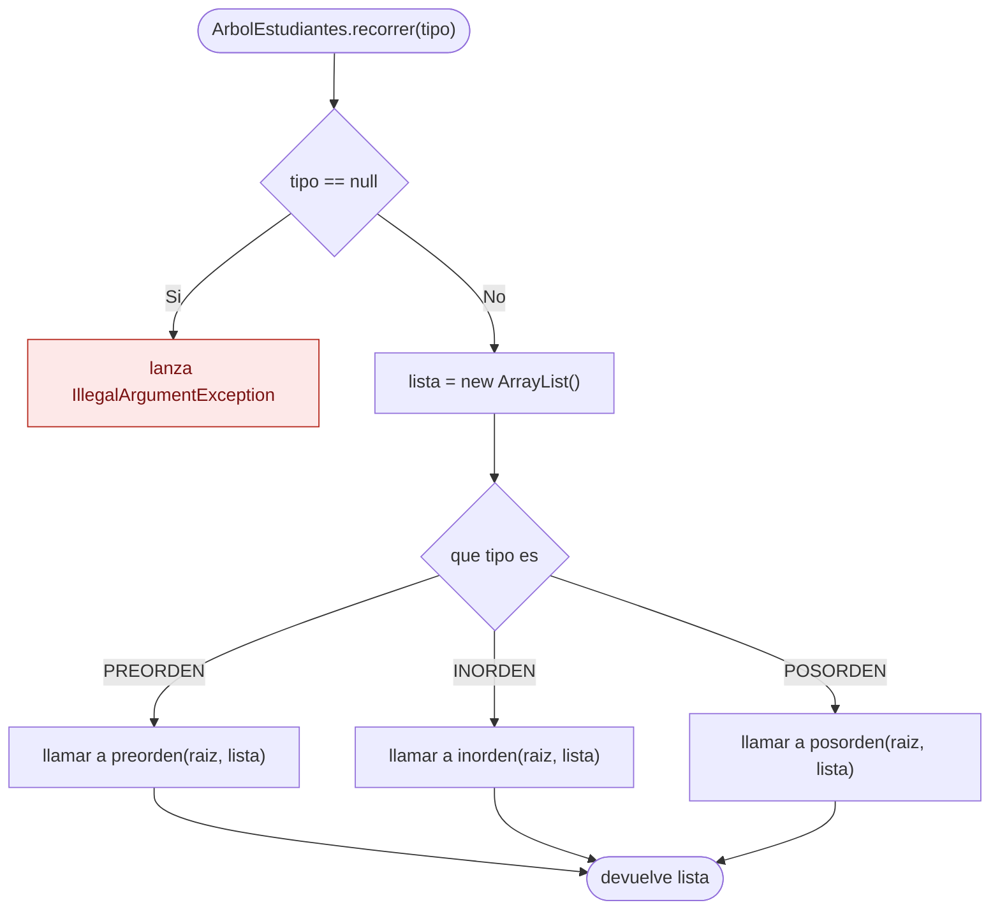
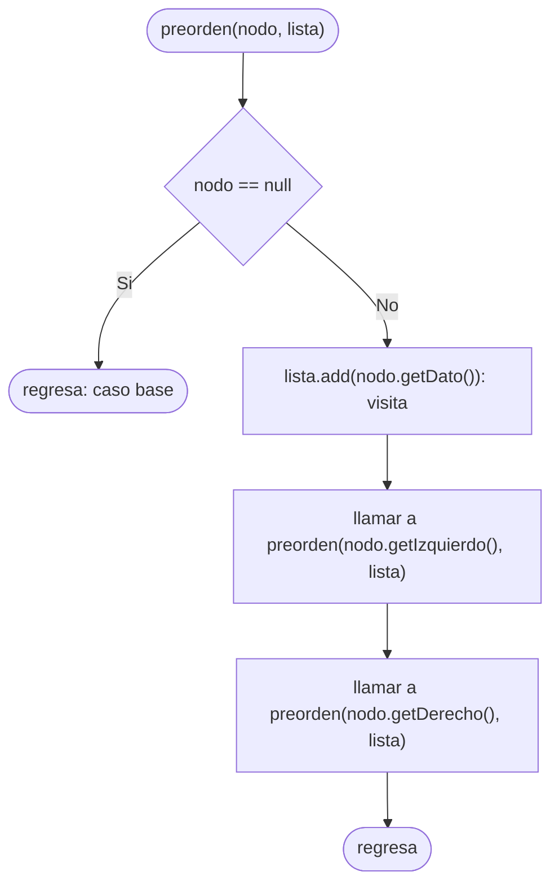
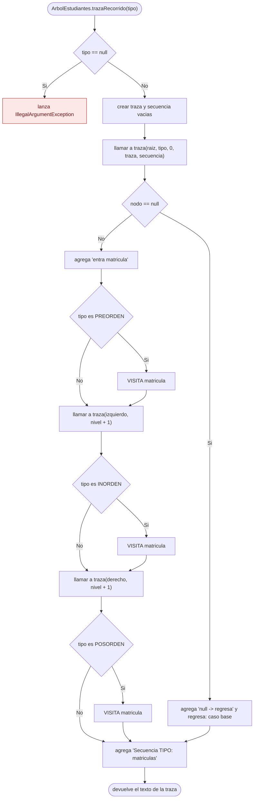

# Diagramas de flujo: recorridos y traza (ABB de estudiantes)

> **Responsable:** Darwin · **Rama:** `Rama-Joel`
>
> **Para que:** mostrar las decisiones de recorrer (preorden, inorden y posorden recursivos) y de trazaRecorrido (traza con sangria por nivel).

Un diagrama de flujo recorre las decisiones de un metodo, de la entrada hasta el valor que devuelve. Cada diagrama sigue el codigo de `src/negocio/ArbolEstudiantes.java`: las mismas condiciones y los mismos resultados.

Convencion de formas (igual que el Grupo 1): inicio y fin en rectangulo redondeado, proceso en rectangulo, decision en rombo, error en rectangulo rojo. La llamada recursiva es un paso explicito, no un ciclo de regreso al inicio. En `recorrer` y `trazaRecorrido` el rectangulo rojo es la `IllegalArgumentException` cuando el tipo es null.

## Indice

| Metodo | Clase | Capa | Archivo fuente |
|---|---|---|---|
| [recorrer(tipo)](#recorrer) | `ArbolEstudiantes` | negocio | `src/negocio/ArbolEstudiantes.java` |
| [preorden(nodo, lista)](#preorden) | `ArbolEstudiantes` | negocio | `src/negocio/ArbolEstudiantes.java` |
| [trazaRecorrido(tipo)](#traza) | `ArbolEstudiantes` | negocio | `src/negocio/ArbolEstudiantes.java` |

## Capa negocio, clase ArbolEstudiantes

### Metodo recorrer(tipo)
Paquete principal: SJA-UTA | Capa: negocio | Paquete: negocio | Clase: ArbolEstudiantes | Archivo: src/negocio/ArbolEstudiantes.java

Firma: `public List<Estudiante> recorrer(TipoRecorrido tipo)`

El metodo publico valida el tipo: si es null lanza `IllegalArgumentException`. Si no, crea una lista vacia y delega en el metodo recursivo que corresponde, empezando desde la raiz. Si el arbol esta vacio, la raiz es null, el recorrido no agrega nada y devuelve la lista vacia, nunca null. Cada nodo se visita una sola vez: O(n).

Ejemplo: `recorrer(INORDEN)` en el paralelo `SW-N3-B` devuelve los estudiantes ordenados por matricula.

### Metodo preorden(nodo, lista)
Paquete principal: SJA-UTA | Capa: negocio | Paquete: negocio | Clase: ArbolEstudiantes | Archivo: src/negocio/ArbolEstudiantes.java

Firma: `private void preorden(NodoEstudiante nodo, List<Estudiante> lista)`

Cada llamada pregunta si el nodo es null; si lo es, ese es el **caso base** y regresa sin hacer nada. Si no, visita el nodo (lo agrega a la lista) y se llama a si misma con el hijo izquierdo y luego con el derecho (**caso recursivo**). En `inorden` la visita va entre las dos llamadas y en `posorden` despues de ambas; el resto del diagrama es igual.

Ejemplo: con raiz 50, preorden visita 50, baja por la izquierda (30, 20, 40, 35, 45) y despues por la derecha (70, 60, 65, 80).

### Metodo trazaRecorrido(tipo)
Paquete principal: SJA-UTA | Capa: negocio | Paquete: negocio | Clase: ArbolEstudiantes | Archivo: src/negocio/ArbolEstudiantes.java

Firma: `public String trazaRecorrido(TipoRecorrido tipo)`

`trazaRecorrido` valida el tipo y arma el texto con un `StringBuilder`. El metodo privado `traza` hace el mismo recorrido recursivo, pero escribe una linea por paso con dos espacios de sangria por cada nivel: `entra`, `null -> regresa` en el caso base y `VISITA` en el momento que corresponde al tipo (antes de los hijos en preorden, entre ellos en inorden, despues en posorden). Al final agrega la linea `Secuencia <TIPO>: ...` solo con matriculas. Es la evidencia de los recorridos. Complejidad O(n).

Ejemplo: `SW-N3-B` con `PREORDEN` termina en `Secuencia PREORDEN: 50 30 20 40 35 45 70 60 65 80`.