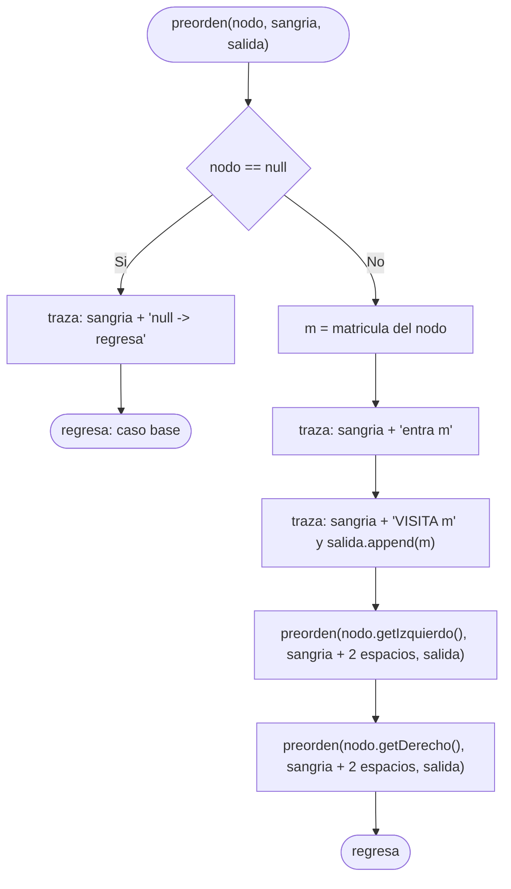
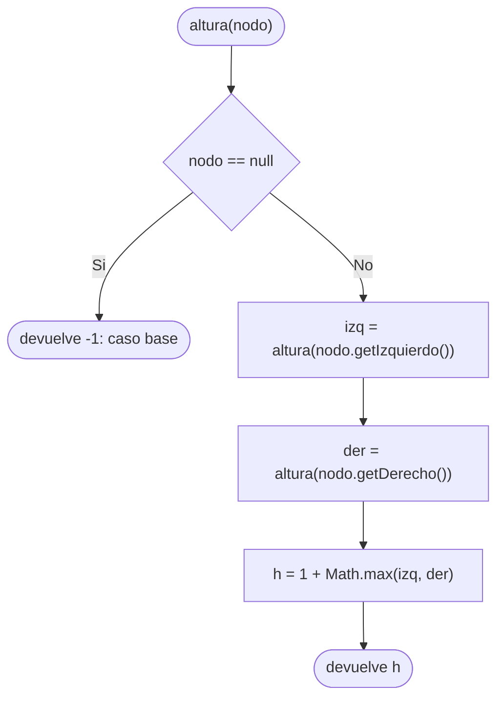
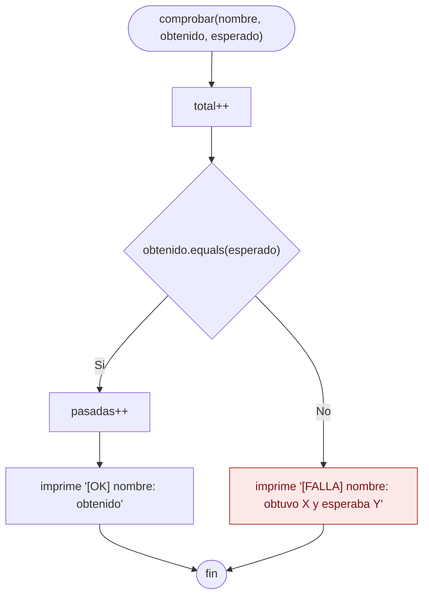
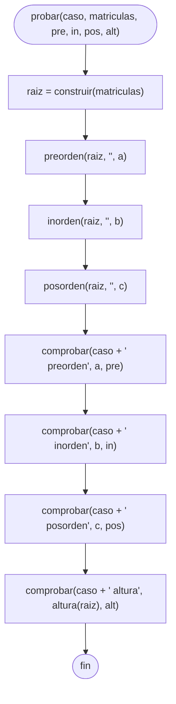

# Diagramas de flujo: reto de recorridos (SW-N3-A)

> **Responsable:** Monica · **Rama:** `Sara-Tacuri`
>
> **Para que:** mostrar las decisiones del recorrido recursivo con traza (preorden, inorden y posorden), de la altura extra y de las funciones que comparan cada resultado y marcan [OK] o [FALLA].

Un diagrama de flujo recorre las decisiones de un metodo, de la entrada hasta el valor que devuelve. Cada diagrama sigue el codigo de `reto/solucion/RetoSolucion.java`: las mismas condiciones y los mismos resultados.

Convencion de formas (igual que el Grupo 1): inicio y fin en rectangulo redondeado, proceso en rectangulo, decision en rombo, error en rectangulo rojo. La llamada recursiva es un paso explicito, no un ciclo de regreso al inicio. En el reto, el rectangulo rojo marca una prueba que falla.

## Indice

| Metodo | Clase | Capa | Archivo fuente |
|---|---|---|---|
| [preorden(nodo, sangria, salida)](#preorden) | `RetoSolucion` | reto | `reto/solucion/RetoSolucion.java` |
| [altura(nodo)](#altura) | `RetoSolucion` | reto | `reto/solucion/RetoSolucion.java` |
| [comprobar(nombre, obtenido, esperado)](#comprobar) | `RetoSolucion` | reto | `reto/solucion/RetoSolucion.java` |
| [probar(caso, matriculas, pre, in, pos, alt)](#probar) | `RetoSolucion` | reto | `reto/solucion/RetoSolucion.java` |

`inorden` y `posorden` tienen el mismo diagrama que `preorden`: solo cambia el lugar de la visita (en medio o al final).

## Paquete reto.solucion, clase RetoSolucion

### Metodo preorden(nodo, sangria, salida)
Paquete principal: SJA-UTA | Capa: reto | Paquete: reto.solucion | Clase: RetoSolucion | Archivo: reto/solucion/RetoSolucion.java

Firma: `static void preorden(NodoEstudiante nodo, String sangria, StringBuilder salida)`

Cada llamada pregunta si el nodo es `null`; si lo es, escribe `null -> regresa` y vuelve a quien la llamo (**caso base**). Si no, escribe `entra`, visita el nodo (escribe `VISITA` y agrega la matricula a `salida`) y despues se llama a si misma con el hijo izquierdo y al terminar con el derecho (**caso recursivo**). La `sangria` crece 2 espacios por nivel: es la pila de llamadas. La traza solo se imprime si `conTraza` esta en `true`. Visita cada nodo una vez: O(n).

En `inorden` la visita va entre las dos llamadas (izquierdo, VISITA, derecho) y en `posorden` va al final (izquierdo, derecho, VISITA). Lo demas es igual.

Ejemplo: con el ABB de SW-N3-A (45, 25, 70, 10, 30, 60, 90, 27, 65) el preorden es 45 25 10 30 27 70 60 65 90.

### Metodo altura(nodo)
Paquete principal: SJA-UTA | Capa: reto | Paquete: reto.solucion | Clase: RetoSolucion | Archivo: reto/solucion/RetoSolucion.java

Firma: `static int altura(NodoEstudiante nodo)`

Es el extra del reto. La altura se mide en aristas, como en el Grupo 1: un arbol vacio vale -1 (**caso base**) y por eso una hoja queda en 0. En el caso recursivo se calcula la altura de cada lado y se toma la mayor mas 1. En SW-N3-A el camino mas largo es 45, 25, 30, 27, o sea 3 aristas.

### Metodo comprobar(nombre, obtenido, esperado)
Paquete principal: SJA-UTA | Capa: reto | Paquete: reto.solucion | Clase: RetoSolucion | Archivo: reto/solucion/RetoSolucion.java

Firma: `static void comprobar(String nombre, String obtenido, String esperado)`

`comprobar` cuenta siempre una prueba (`total++`). Si lo obtenido es igual a lo esperado suma una a `pasadas` e imprime `[OK]`; si no, imprime `[FALLA]` con lo que obtuvo y lo que esperaba (rojo en el diagrama). No lanza excepciones: solo cuenta y muestra.

### Metodo probar(caso, matriculas, pre, in, pos, alt)
Paquete principal: SJA-UTA | Capa: reto | Paquete: reto.solucion | Clase: RetoSolucion | Archivo: reto/solucion/RetoSolucion.java

Firma: `static void probar(String caso, int[] matriculas, String pre, String in, String pos, int alt)`

`probar` arma el ABB con `construir`, corre los tres recorridos y la altura, y llama a `comprobar` cuatro veces, una por cada resultado. `main` la usa con cinco casos: SW-N3-A, arbol vacio, un solo nodo, cadena 10-20-30-40 y repetido (20, 30, 30, 10). Son 5 casos por 4 comprobaciones: 20 pruebas.

Ejemplo: para SW-N3-A el preorden esperado "45 25 10 30 27 70 60 65 90" coincide con el obtenido y se imprime `[OK] Reto SW-N3-A preorden`. Al final `main` imprime `Resultado: 20/20 pruebas OK`.
