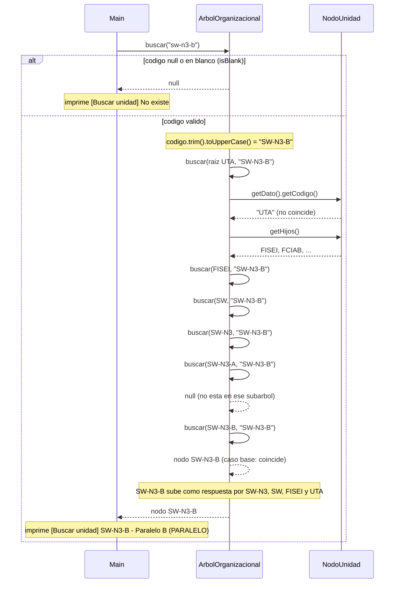
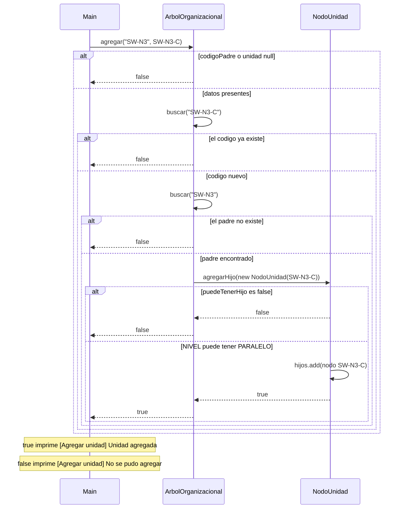

# Diagrama de secuencia: agregar y buscar (arbol general)

> **Responsable:** Damian · **Rama:** `Damian_Cunalata`
>
> **Para que:** explicar como se busca recursivamente una unidad entre las 88 y como se agrega respetando codigo unico y jerarquia.

Un diagrama de secuencia muestra el orden de las llamadas entre objetos durante una operacion. La flecha continua es una llamada. La flecha punteada es una respuesta. El bloque `alt` separa el camino normal de los casos de error. Los nombres de metodos, condiciones y mensajes son los mismos del codigo.

## Paquete negocio

### Buscar una unidad

`Main` (opcion 3) busca el paralelo escribiendo `sw-n3-b` en minusculas.

`buscar` primero revisa que el codigo no sea null ni este en blanco (`isBlank()`, que tambien cubre un texto de solo espacios); en ese caso devuelve `null` y el menu muestra "No existe". Si es valido, lo normaliza con `trim().toUpperCase()`, porque `UnidadAcademica` guarda los codigos en mayusculas, y delega en el metodo privado recursivo empezando en la raiz `UTA`. Cada llamada pregunta "eres tu?": si el codigo del nodo coincide, lo devuelve (**caso base**). Si no, se llama a si misma con cada hijo (**caso recursivo**) y devuelve el primero que lo encuentre; si un hijo devuelve `null`, sigue con el siguiente hermano. En el diagrama solo se detallan `getDato()` y `getHijos()` para UTA; en los demas niveles pasa lo mismo.

Ejemplo: con `sw-n3-b` el camino es UTA, FISEI, SW, SW-N3, SW-N3-A (devuelve `null`) y SW-N3-B (coincide). El nodo encontrado sube por todas las llamadas hasta `Main`, que imprime `[Buscar unidad] SW-N3-B - Paralelo B (PARALELO)`. Como el arbol general no esta ordenado, en el peor caso revisa los 88 nodos: **O(n)**.

### Agregar una unidad

`Main` (opcion 2) agrega el paralelo `SW-N3-C` bajo el nivel `SW-N3`.

`agregar` hace tres revisiones antes de tocar el arbol: que el codigo del padre y la unidad no sean null, que el codigo de la unidad no exista en ninguna parte del arbol (usa el mismo `buscar` recursivo) y que el padre exista. Si todo pasa, crea el `NodoUnidad` y llama a `agregarHijo`, el metodo del Grupo 1 que valida la jerarquia con `puedeTenerHijo` y, si es valida, hace `hijos.add(hijo)`. Cada tipo solo acepta el siguiente: UNIVERSIDAD > FACULTAD > CARRERA > NIVEL > PARALELO. No se puede saltar un nivel (una CARRERA no acepta un PARALELO) y un PARALELO no acepta hijos. `agregar` solo devuelve `true` o `false`; el texto lo imprime `Main`. La rama de datos null no se alcanza desde el menu: si se escribe un codigo vacio o un tipo invalido, `UnidadAcademica` lanza `IllegalArgumentException` y `Main` muestra `[Agregar unidad] [ERROR] ...`.

Ejemplo: `SW-N3-C` bajo `SW-N3` devuelve `true` y se imprime "Unidad agregada". Repetirlo devuelve `false` porque el codigo ya existe, y poner la facultad `FX` bajo la carrera `SW` devuelve `false` por la jerarquia; en los dos casos se imprime "No se pudo agregar". Las 88 unidades de `DatosPrueba.cargar` se crean con este mismo `agregar`. Complejidad **O(n)** por las busquedas.
