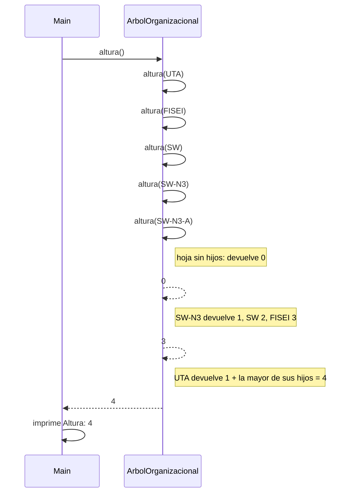

# Diagramas de secuencia: altura (árbol general)

> **Responsable:** Kenneth · **Rama:** `Mateo-Chalco`
>
> **Para qué:** mostrar quién llama a quién en altura: el menú, el método público y las llamadas recursivas por cada hijo.

Un diagrama de secuencia muestra el orden de los mensajes entre `Main` y `ArbolOrganizacional`. Sigue el código de `src/negocio/ArbolOrganizacional.java` y de la opción 4 de `src/app/Main.java`.

## Índice

| Diagrama | Participantes |
|---|---|
| [altura()](#altura) | `Main`, `ArbolOrganizacional` |

## altura()

`Main` (opción 4) llama a `altura()`, que empieza desde la raíz `UTA`. Cada llamada se repite con cada uno de sus hijos y se queda con la altura mayor. Una hoja devuelve 0, y al volver cada nodo suma 1 a la mayor altura de sus hijos: `SW-N3-A` da 0, `SW-N3` da 1, `SW` da 2, `FISEI` da 3 y `UTA` da 4. Por eso la opción 4 muestra `Altura: 4`. Se visita cada nodo una sola vez: O(n).
