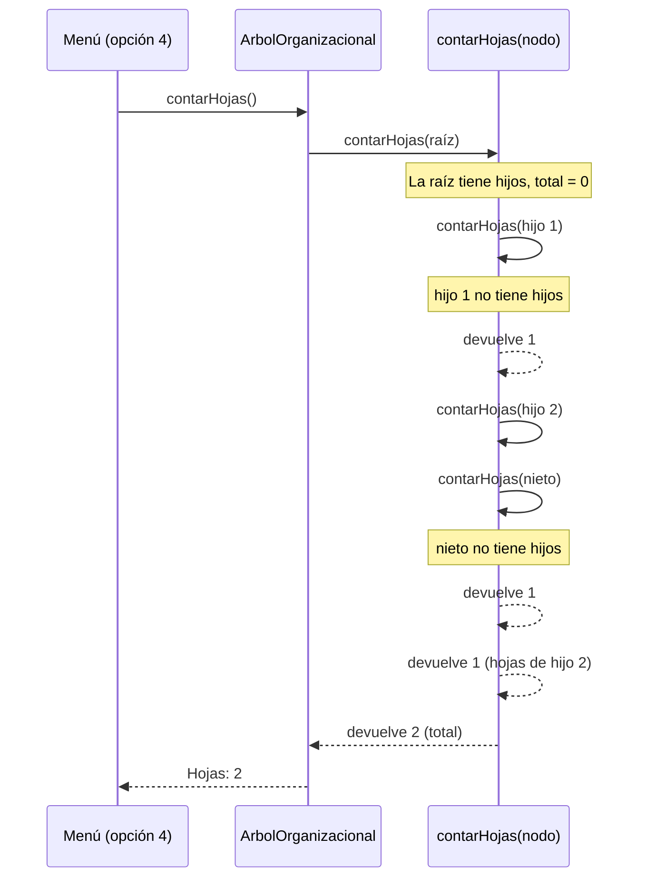

# Diagrama de secuencia: contarHojas

Ejemplo con una unidad que tiene dos hijos: el primero es una hoja y el segundo tiene un hijo hoja.

Con los datos de prueba del repo, el mismo proceso recorre las 88 unidades y el menú muestra el total de hojas.