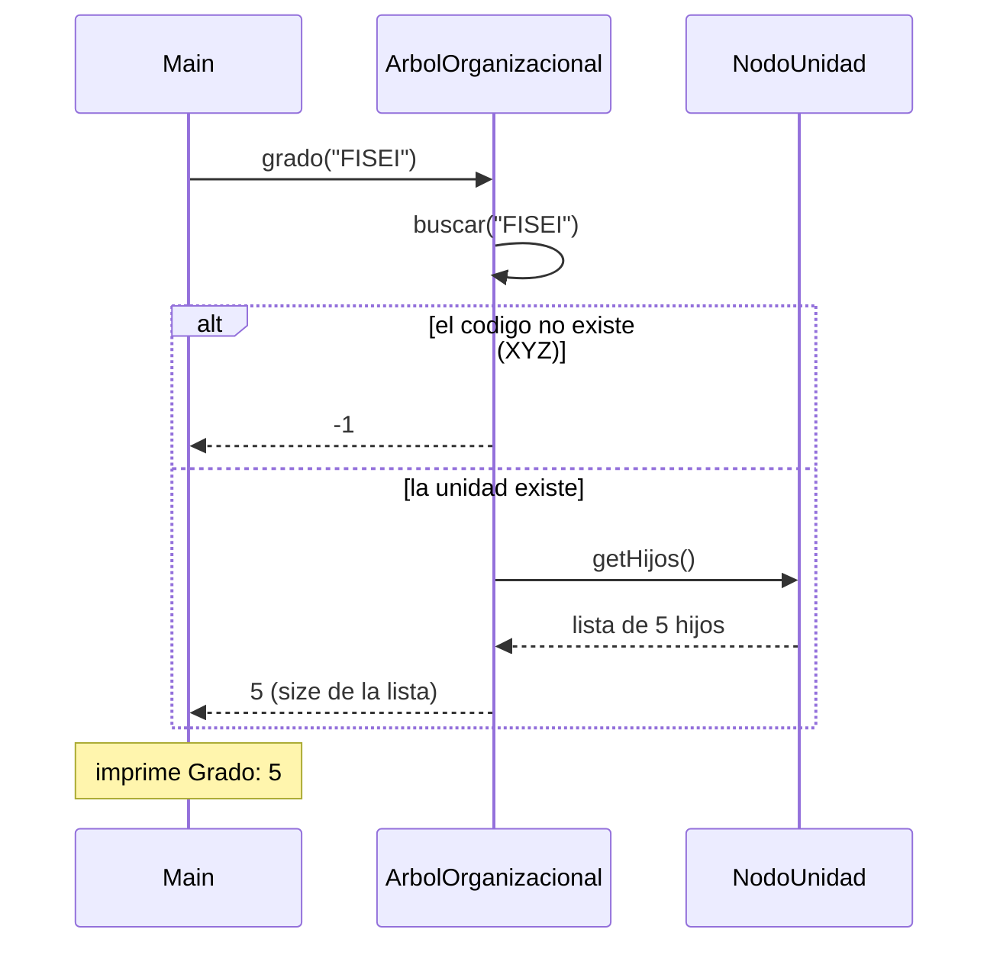
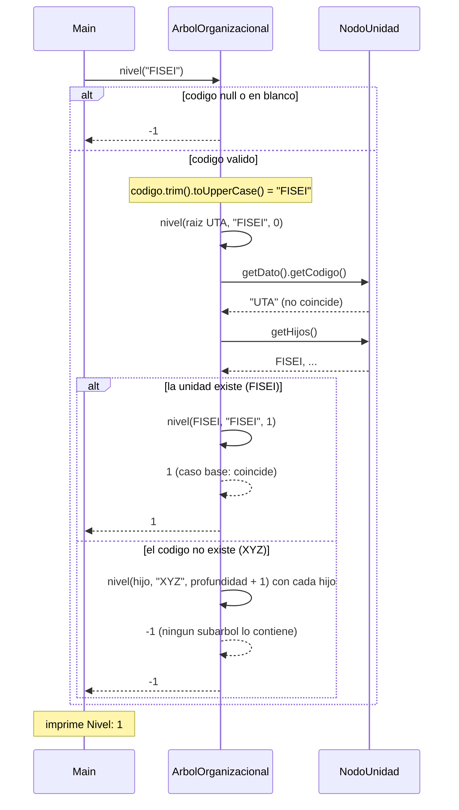

# Diagrama de secuencia: grado y nivel (arbol general)

> **Responsable:** Luis · **Rama:** `Rama-Luis-Silva`
>
> **Para que:** explicar como se calculan el grado y el nivel de una unidad, y que ocurre cuando el codigo no existe.

Un diagrama de secuencia muestra el orden de las llamadas entre objetos durante una operacion. La flecha continua es una llamada. La flecha punteada es una respuesta. El bloque `alt` separa el camino normal de los casos de error. Los nombres de metodos, condiciones y mensajes son los mismos del codigo.

## Paquete negocio

### Grado de una unidad

`Main` (opcion 5) pide el grado del codigo `FISEI`.

`grado` usa el `buscar` recursivo para encontrar la unidad. Si no la encuentra, como con `XYZ`, responde `-1`. Si la encuentra, pide su lista de hijos con `getHijos()` y devuelve cuantos son: `FISEI` tiene 5, `UTA` tiene 10 y `SW-N3-B`, que es hoja, tiene 0. Complejidad **O(n)** por la busqueda.

### Nivel de una unidad

`Main` (opcion 5) pide el nivel del codigo `FISEI`.

`nivel` valida y normaliza el codigo, y delega en el metodo recursivo desde la raiz `UTA`, que esta en el nivel 0. Cada llamada pregunta si el nodo es el buscado; si coincide devuelve la profundidad (**caso base**), y si no se llama con cada hijo sumando 1 (**caso recursivo**). Para `FISEI` la respuesta sube en una sola llamada: `1`. Para `SW-N3-B` la profundidad va 0, 1, 2, 3 y 4. Con `XYZ` ninguna llamada lo encuentra y devuelve `-1`. Complejidad **O(n)**.