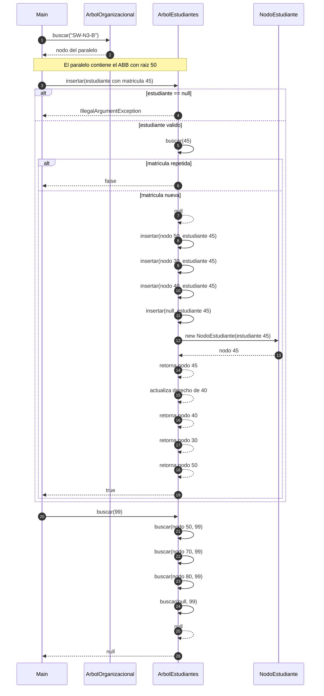

# Diagrama de secuencia: insertar y buscar (ABB)

**Responsable:** Kenneth · **Rama:** `Mateo-Chalco`

Pendiente: completado por Kenneth en su rama.

**Que debe poner:** un diagrama Mermaid `sequenceDiagram` de `insertar(45)` bajando 50, 30, 40 hasta `null` (caso base) con `alt` para `null`, repetido y nuevo; y `buscar(99)` hasta `null`. Flecha continua = llamada, punteada = respuesta, `alt` para los casos. Debajo, un parrafo que lo explique con los datos de la expo.

## Diagrama de secuencia

## Explicacion

El programa primero localiza el paralelo `SW-N3-B` mediante `ArbolOrganizacional.buscar`. Una vez obtenido el paralelo, se trabaja con su arbol binario de estudiantes, cuya raiz inicial es la matricula **50**.

En la insercion del estudiante con matricula **45**, el metodo `insertar` primero valida que el estudiante no sea `null`. Luego llama a `buscar(45)` para verificar que la matricula no este repetida. Como no existe, comienza la insercion recursiva: compara 45 con 50 y baja a la izquierda; luego compara 45 con 30 y baja a la derecha; despues compara 45 con 40 y vuelve a bajar a la derecha hasta llegar a `null`, que es el caso base. En ese punto se crea un nuevo `NodoEstudiante` y la recursion retorna actualizando los enlaces hasta conservar el nuevo nodo 45 como hijo derecho de 40.

En la busqueda de la matricula **99**, el metodo `buscar` recorre un solo camino del ABB: 50, 70, 80 y finalmente `null`. Al llegar a `null`, devuelve `null`, indicando que la matricula no existe.

Estas operaciones trabajan sobre un unico camino del ABB, por lo que su complejidad es **O(h)**, donde `h` es la altura del arbol. En el peor caso, si el ABB se degenera, la complejidad puede llegar a **O(n)**.