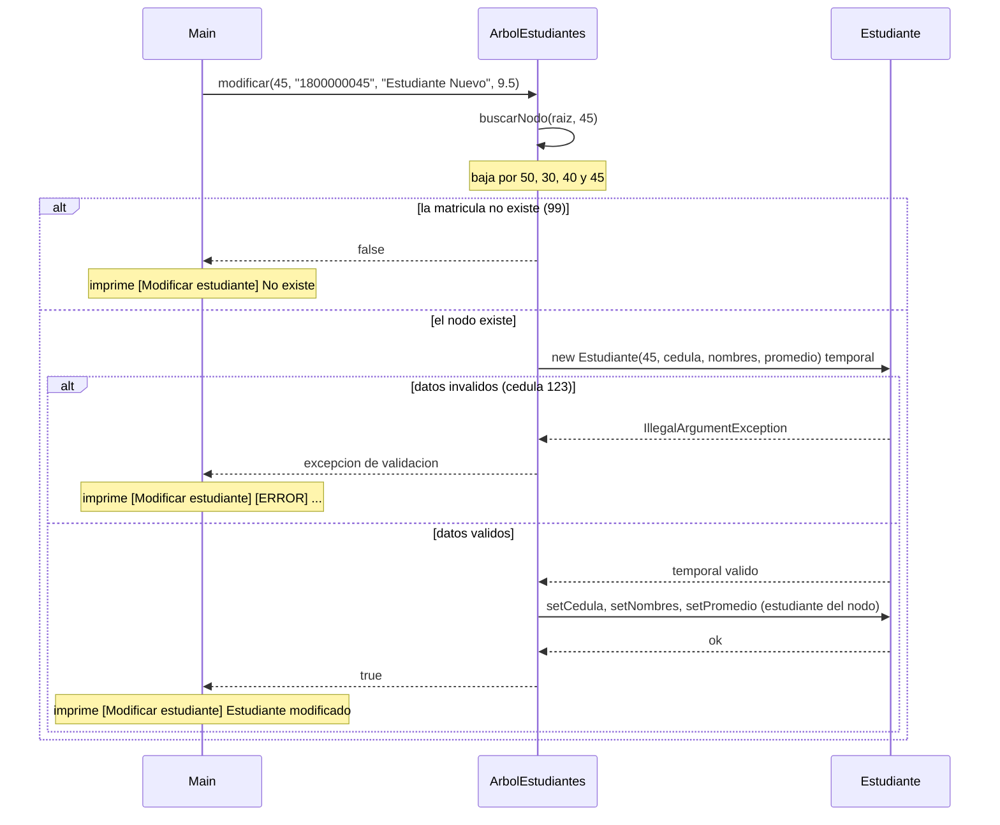
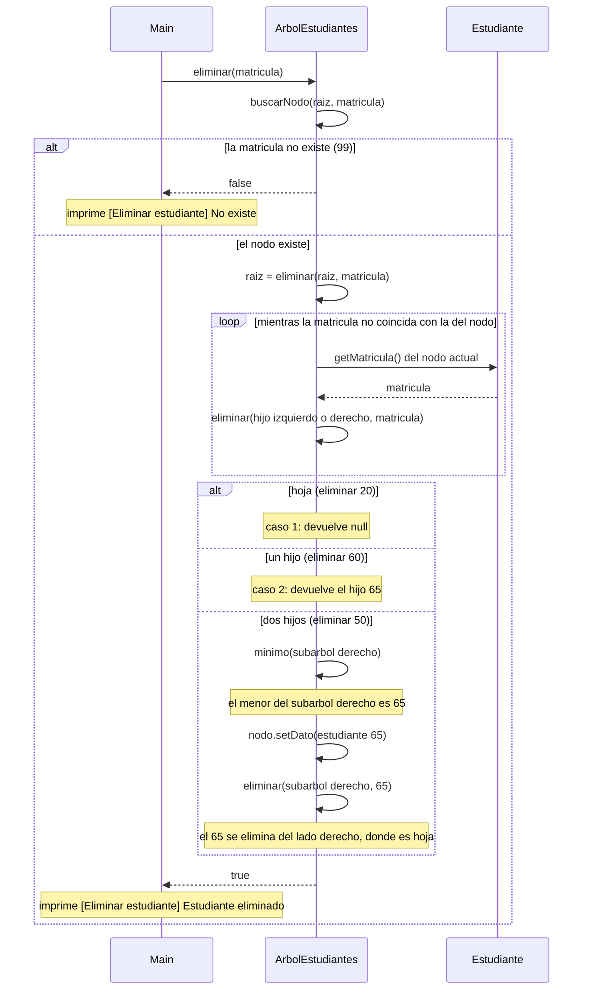

# Diagrama de secuencia: modificar y eliminar (ABB de estudiantes)

> **Responsable:** Luis · **Rama:** `Rama-Luis-Silva`
>
> **Para que:** explicar como se modifica un estudiante validando antes de cambiar y como se elimina en los tres casos: hoja, un hijo y dos hijos.

Un diagrama de secuencia muestra el orden de las llamadas entre objetos durante una operacion. La flecha continua es una llamada. La flecha punteada es una respuesta. El bloque `alt` separa el camino normal de los casos de error. Los nombres de metodos, condiciones y mensajes son los mismos del codigo.

## Paquete negocio

### Modificar un estudiante

`Main` (opcion 11) modifica al estudiante 45 del paralelo `SW-N3-B`.

`modificar` primero busca el nodo con `buscarNodo`, un metodo privado recursivo propio que baja por la izquierda si la matricula es menor y por la derecha si es mayor. Si llega a `null`, la matricula no existe y devuelve `false` sin tocar nada. Si el nodo existe, **valida antes de cambiar**: crea un `Estudiante` temporal con los datos nuevos, y si alguno es invalido (por ejemplo la cedula `123`) la excepcion sale antes de que el estudiante real cambie. Solo con datos validos aplica `setCedula`, `setNombres` y `setPromedio` sobre el estudiante del nodo. La matricula nunca se cambia porque es la clave de orden del arbol.

Ejemplo: `modificar(45, "1800000045", "Estudiante Nuevo", 9.5)` baja por 50, 30, 40 y 45, valida y devuelve `true`, y el menu imprime `Estudiante modificado`. Con cedula `123` se imprime el error de validacion y con la matricula `99` se imprime `No existe`. Complejidad **O(h)**, peor caso O(n).

### Eliminar un estudiante

`Main` (opcion 12) elimina estudiantes de `SW-N3-B` (con el 45 ya insertado): primero el 20, luego el 60 y luego el 50.

`eliminar` primero comprueba con `buscarNodo` que la matricula exista; si no, devuelve `false` y el arbol queda igual. Si existe, llama al metodo privado recursivo desde la raiz y guarda el resultado en `raiz`, porque la raiz misma puede cambiar. Cada llamada compara matriculas y baja por un lado (**caso recursivo**), y cada una devuelve el nodo que debe quedar enlazado en ese lugar con `setIzquierdo` o `setDerecho`. Si llega a `null` es el **caso base**. Al encontrar el nodo se aplican tres casos: hoja (devuelve `null`), un hijo (devuelve ese hijo) y dos hijos (copia el **sucesor inorden**, el menor del subarbol derecho, con `setDato` y lo elimina del lado derecho).

Ejemplo, en orden:

1. `eliminar(20)`: es hoja y el nodo se reemplaza por `null`.
2. `eliminar(60)`: solo tiene a 65 a la derecha, asi que 65 sube a su lugar.
3. `eliminar(50)`: tiene dos hijos (30 y 70). El menor del subarbol derecho (70 con 65 y 80) es 65, que se copia a la raiz y luego se elimina del lado derecho.

Despues de los tres, la opcion 14 en INORDEN muestra `30 35 40 45 65 70 80` y la raiz es 65. Complejidad **O(h)**, peor caso O(n).
