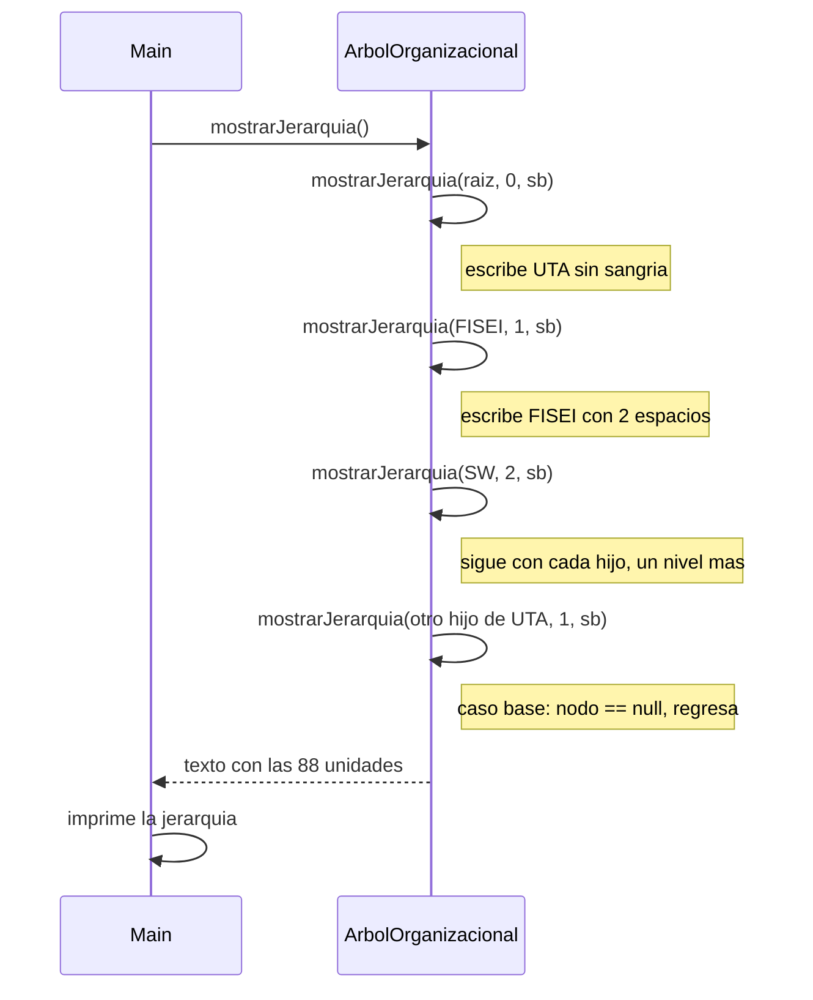

# Diagramas de secuencia: mostrarJerarquia (arbol general)

> **Responsable:** Darwin · **Rama:** `Rama-Joel`
>
> **Para que:** mostrar quien llama a quien en mostrarJerarquia: el menu, el metodo publico y las llamadas recursivas por cada hijo.

Un diagrama de secuencia muestra el orden de los mensajes entre `Main` y `ArbolOrganizacional`. Sigue el codigo de `src/negocio/ArbolOrganizacional.java` y de la opcion 1 de `src/app/Main.java`.

## Indice

| Diagrama | Participantes |
|---|---|
| [mostrarJerarquia()](#mostrar) | `Main`, `ArbolOrganizacional` |

## mostrarJerarquia()

`Main` (opcion 1) llama a `mostrarJerarquia()`. El metodo publico crea el `StringBuilder` y llama al privado con la raiz y nivel 0. Cada llamada escribe su unidad con 2 espacios por nivel y despues se llama una vez por cada hijo, con un nivel mas. Al terminar, devuelve el texto completo y `Main` lo imprime. La secuencia de escritura es la de un preorden: UTA, FISEI, SW, SW-N3, SW-N3-A, SW-N3-B, SW-N4, TI, y asi hasta las 88 unidades. Complejidad O(n).
