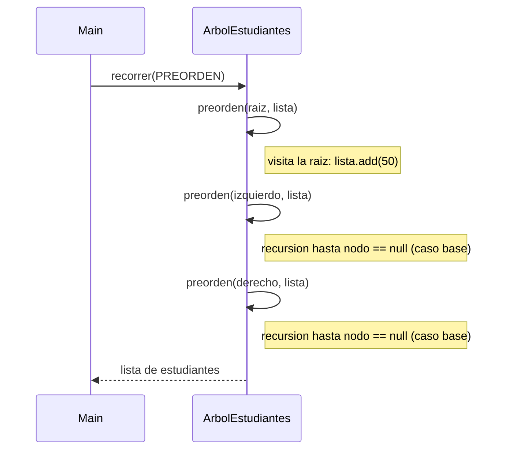
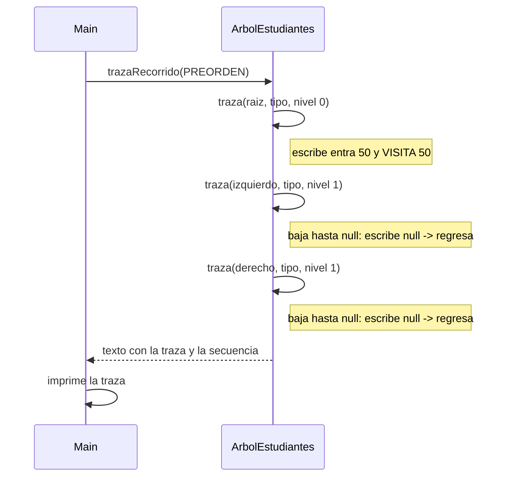

# Diagramas de secuencia: recorridos y traza (ABB de estudiantes)

> **Responsable:** Darwin · **Rama:** `Rama-Joel`
>
> **Para que:** mostrar quien llama a quien en recorrer(PREORDEN) y en trazaRecorrido, con las llamadas recursivas izquierda y derecha y el caso base null.

Un diagrama de secuencia muestra el orden de los mensajes entre `Main` y `ArbolEstudiantes`. Cada diagrama sigue el codigo de `src/negocio/ArbolEstudiantes.java` y de la opcion 14 de `src/app/Main.java`.

## Indice

| Diagrama | Participantes |
|---|---|
| [recorrer(PREORDEN)](#recorrer) | `Main`, `ArbolEstudiantes` |
| [trazaRecorrido(tipo)](#traza) | `Main`, `ArbolEstudiantes` |

## recorrer(PREORDEN)

`Main` pide el recorrido y `ArbolEstudiantes` llama a `preorden` con la raiz. Cada llamada visita el nodo, luego se llama con el hijo izquierdo y despues con el derecho. Cuando el nodo es null (caso base) regresa sin agregar nada. Al terminar devuelve la lista completa a `Main`. Complejidad O(n).

## trazaRecorrido(tipo)

`Main` (opcion 14) pide el paralelo y el tipo y llama a `trazaRecorrido`. El metodo recursivo `traza` escribe una linea por paso con una sangria mas por cada nivel: `entra`, `VISITA` en el momento que corresponde al tipo y `null -> regresa` en el caso base. Al final devuelve el texto con la linea `Secuencia PREORDEN: ...` y `Main` lo imprime.

Para el paralelo `SW-N3-B` (con el 45 de Kenneth) la secuencia en preorden es: `50 30 20 40 35 45 70 60 65 80`.