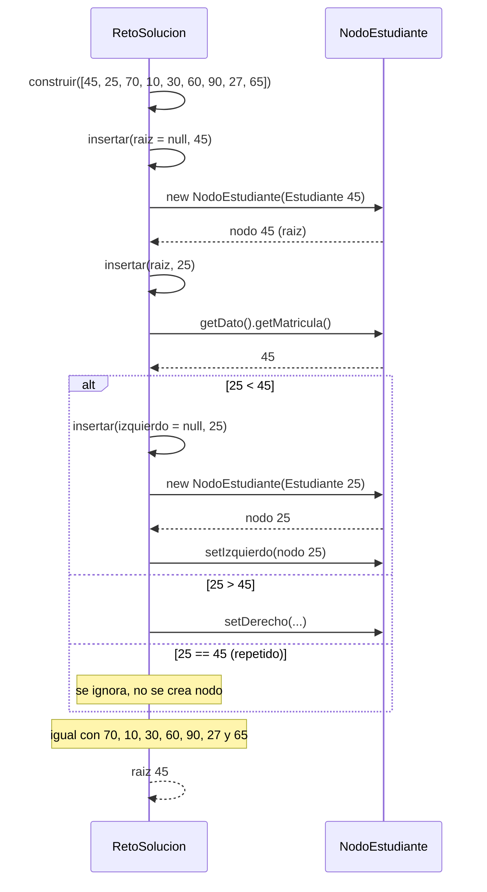
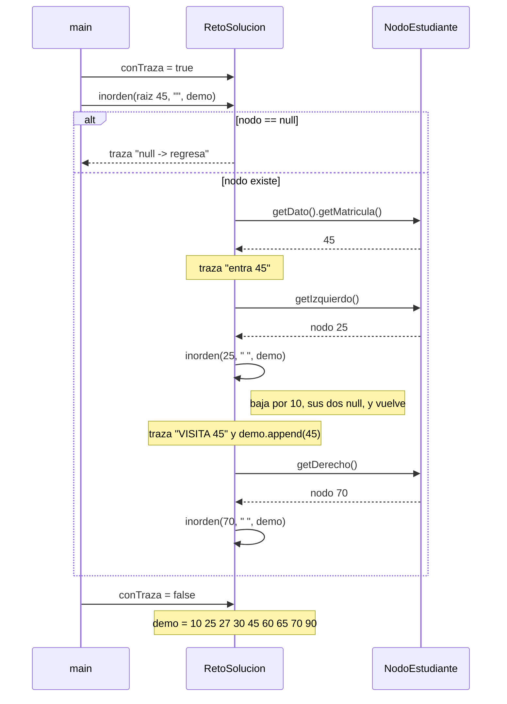
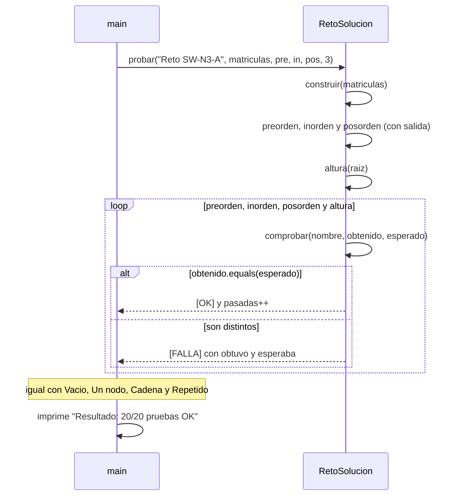

# Diagrama de secuencia: reto de recorridos (SW-N3-A)

> **Responsable:** Monica · **Rama:** `Sara-Tacuri`
>
> **Para que:** explicar como el reto construye el ABB del paralelo SW-N3-A, lo recorre con traza y comprueba los resultados con [OK] o [FALLA].

Un diagrama de secuencia muestra el orden de las llamadas entre objetos durante una operacion. La flecha continua es una llamada. La flecha punteada es una respuesta. El bloque `alt` separa los casos posibles. Los nombres de metodos, condiciones y mensajes son los mismos del codigo.

## Paquete reto.solucion

### Construir el ABB de SW-N3-A

`RetoSolucion` inserta las matriculas 45, 25, 70, 10, 30, 60, 90, 27, 65 con su propio `insertar`, sin usar `ArbolEstudiantes`.

`insertar` es recursivo. Si el nodo es `null` crea el `NodoEstudiante` (**caso base**: lugar libre). Si la matricula es menor, baja por la izquierda; si es mayor, por la derecha (**caso recursivo**), y engancha el resultado con `setIzquierdo` o `setDerecho`. Si la matricula ya existe no hace nada, por eso en el caso repetido (20, 30, 30, 10) el segundo 30 se ignora. Con el orden del reto el 45 queda de raiz, el 25 y el 70 son sus hijos, el 10 y el 30 cuelgan del 25, el 27 del 30, el 60 y el 90 del 70, y el 65 del 60.

### Traza del inorden (la que se muestra en la expo)

`main` activa `conTraza`, ejecuta el inorden del arbol del reto y la desactiva.

`inorden` primero baja por el hijo izquierdo, despues visita el nodo y al final baja por el derecho. La `sangria` crece 2 espacios por nivel, asi la traza se lee como la pila de llamadas. Cuando llega a un `null` escribe `null -> regresa` y vuelve al nodo anterior (**caso base**). `preorden` y `posorden` son iguales y solo cambian el lugar de la visita. Con el arbol del reto las secuencias son: preorden 45 25 10 30 27 70 60 65 90, inorden 10 25 27 30 45 60 65 70 90 (ordenado por matricula) y posorden 10 27 30 25 65 60 90 70 45. Cada nodo se visita una vez: **O(n)**.

### Pruebas

`probar` arma el arbol, corre los tres recorridos y la altura, y por cada resultado llama a `comprobar`, que suma al `total` y marca `[OK]` o `[FALLA]`. Los casos limite son: arbol vacio (secuencias vacias y altura -1), un solo nodo (50, altura 0), la cadena 10, 20, 30, 40 (todo hacia la derecha: preorden e inorden iguales, posorden al reves, 40 30 20 10, altura 3) y el repetido 20, 30, 30, 10 (el segundo 30 se ignora: preorden 20 10 30 y altura 1). Son 5 casos con 4 comprobaciones cada uno y todas pasan: `Resultado: 20/20 pruebas OK`.
