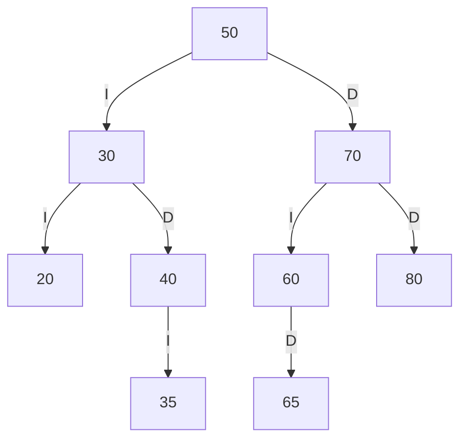
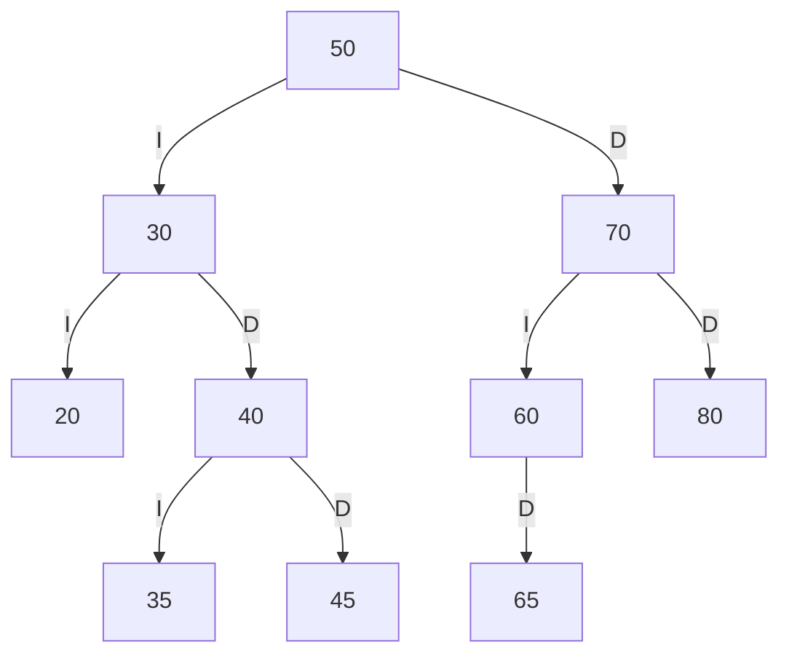
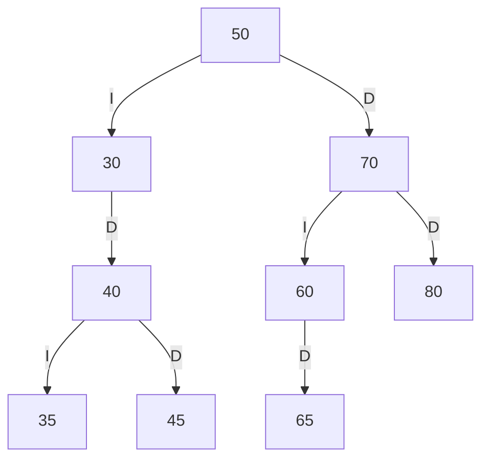
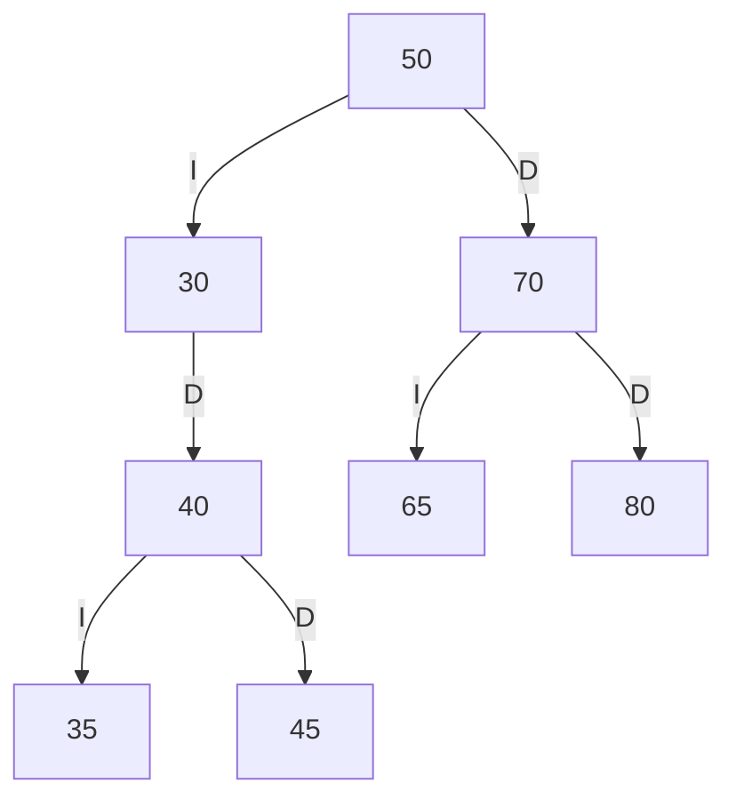
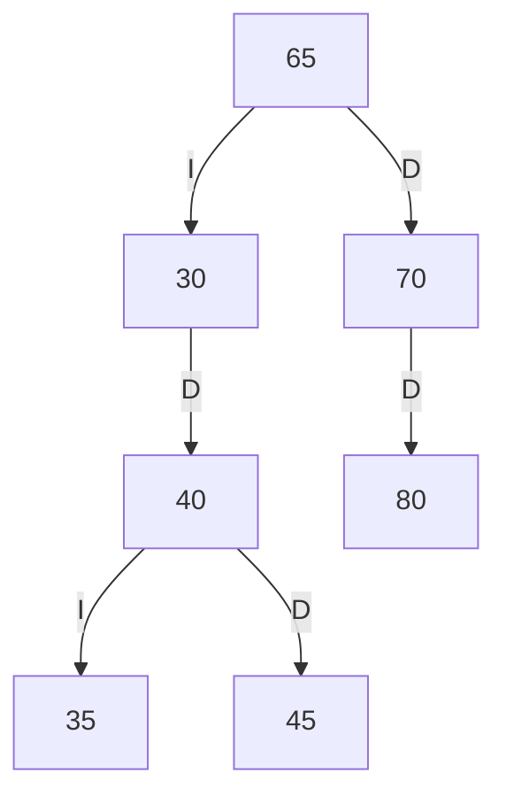

# Trazas de insercion y eliminacion

> **Responsable:** Jampier (Josue)
> **Rama:** `rama---Josue`

## Datos iniciales

Las operaciones se realizaron sobre el ABB del paralelo SW-N3-B.

Matriculas cargadas inicialmente:

50, 30, 70, 20, 40, 60, 80, 35, 65.

Los diagramas representan la estructura resultante de las operaciones verificadas. No son salidas del metodo mostrarJerarquia, que sigue pendiente.

I indica hijo izquierdo y D indica hijo derecho.

## Arbol antes de insertar 45



## Insercion de la matricula 45

Primero, insertar llama a buscar para comprobar que la matricula no exista.

La busqueda y la insercion siguen este camino:

| Nodo actual | Comparacion    | Accion                           |
| ----------- | -------------- | -------------------------------- |
| 50          | 45 < 50        | Continuar por el hijo izquierdo. |
| 30          | 45 > 30        | Continuar por el hijo derecho.   |
| 40          | 45 > 40        | Continuar por el hijo derecho.   |
| null        | Posicion libre | Crear el nodo con matricula 45.  |

El nodo 45 queda como hijo derecho de 40. Los retornos de la recursion conservan los enlaces hasta llegar a la raiz 50.

Mensaje observado en el menu:

```text
[Insertar estudiante] Estudiante insertado
```

### Arbol despues de insertar 45



### Insercion repetida

Al intentar insertar nuevamente la matricula 45, buscar encuentra el estudiante y la insercion devuelve false.

```text
[Insertar estudiante] Matricula repetida
```

La estructura permanece igual y no se crea otro nodo.

## Eliminacion de la matricula 20

Camino de busqueda: 50, 30, 20.

El nodo 20 es una hoja. El metodo devuelve null para esa posicion y el hijo izquierdo de 30 queda vacio.

```text
[Eliminar estudiante] Estudiante eliminado
```

### Arbol despues de eliminar 20



## Eliminacion de la matricula 60

Camino de busqueda: 50, 70, 60.

El nodo 60 tiene un solo hijo: su hijo derecho es 65. El metodo devuelve ese hijo para ocupar su posicion. El hijo izquierdo de 70 pasa a ser 65.

```text
[Eliminar estudiante] Estudiante eliminado
```

### Arbol despues de eliminar 60



## Eliminacion de la matricula 50

El nodo 50 tiene dos hijos.

El metodo obtiene el sucesor inorden: el estudiante con menor matricula del subarbol derecho.

Como antes se elimino 60, el sucesor es 65. Los datos del estudiante 65 se asignan al nodo raiz y luego se elimina el nodo 65 de su posicion anterior.

```text
[Eliminar estudiante] Estudiante eliminado
```

### Arbol despues de eliminar 50



La raiz ahora almacena al estudiante con matricula 65.

Si se eliminara 50 antes de eliminar 60, el sucesor seria 60. El resultado depende del estado del arbol al realizar la operacion.

## Verificacion final

Despues de insertar 45 y eliminar 20, 60 y 50, en ese orden, la opcion 14 con INORDEN produjo:

```text
Secuencia INORDEN: 30 35 40 45 65 70 80
```

Las siete matriculas estan ordenadas y no aparecen los estudiantes eliminados.

Los caminos y las decisiones descritos se obtienen siguiendo el codigo. Los metodos insertar y eliminar no imprimen internamente una traza de sus comparaciones.

## Matricula inexistente

Al intentar eliminar la matricula 99, el metodo devuelve false y el menu informa:

```text
[Eliminar estudiante] No existe
```

El arbol no cambia.

[Volver al README del Grupo 2](../README.md)
