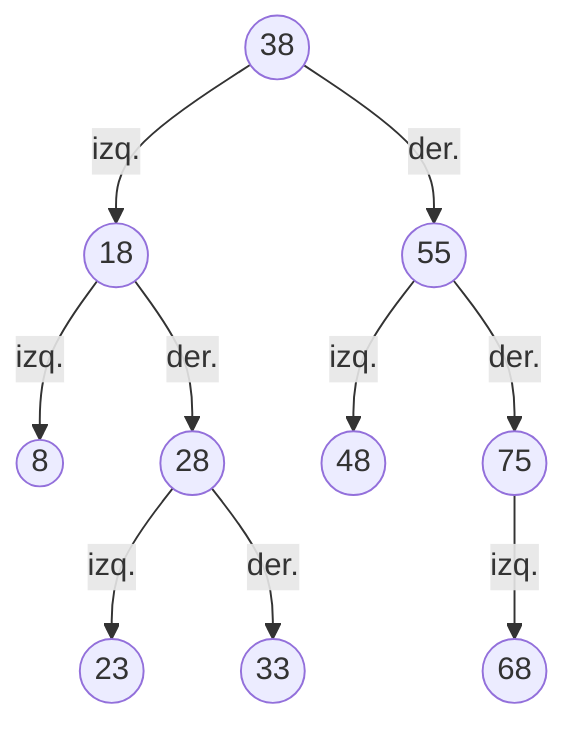
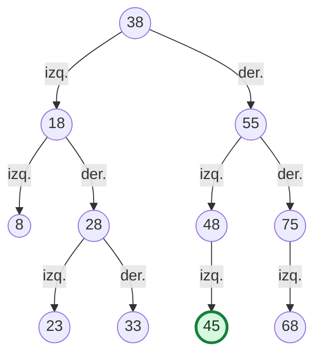

# Estación E1 · Inserción en un Árbol Binario de Búsqueda (ABB)

**APE 3 · Fase 2 · Grupo 2**

**Responsable:** Kenneth · rama `Mateo-Chalco`

Cada grupo resuelve esta parte en su puesto; Kenneth pasa por los grupos ayudando.

## Objetivo

Construir un ABB a partir de una secuencia de matrículas y justificar el recorrido necesario para insertar una nueva matrícula sin alterar la propiedad de orden del árbol.

## Datos de la actividad

Inserta las siguientes matrículas **en el orden indicado**:

`38, 18, 55, 8, 28, 48, 75, 23, 33, 68`

**Matrícula adicional:** `45`.

### Ejercicio para los participantes

1. Dibuja el ABB que se obtiene después de insertar, una por una, las 10 matrículas de la lista.
2. Partiendo de la raíz, decide dónde se insertaría la matrícula **45**. Anota cada nodo que se compara, indica si vas a la izquierda o a la derecha y explica por qué.
3. Señala el **padre** del nuevo nodo y si 45 queda como hijo izquierdo o derecho.
4. Explica qué ocurriría si intentaras insertar 45 nuevamente en un ABB que no permite matrículas repetidas.
5. **Pregunta adicional:** ¿cuál es la altura del árbol antes y después de insertar 45, si la altura se mide en aristas y una hoja tiene altura 0?

**Entrega en el Padlet:**

- En la **columna del grupo**: el **Diagrama 1**, hecho en Mermaid (no a mano), con el ABB, el 45 insertado y su camino resaltado.
- En la **columna Preguntas**, en la nota del grupo: el camino del 45 en la parte **E1** y la **pregunta 1**: ¿cuál es el caso base de insertar y qué ocurre en él?

---

## Solución para el facilitador

### 1. ABB de las 10 matrículas originales

**Recorridos de comprobación, antes de insertar 45:**

- **Preorden (raíz, izquierda, derecha):** 38, 18, 8, 28, 23, 33, 55, 48, 75, 68.
- **Inorden (izquierda, raíz, derecha):** 8, 18, 23, 28, 33, 38, 48, 55, 68, 75.
- **Posorden (izquierda, derecha, raíz):** 8, 23, 33, 28, 18, 48, 68, 75, 55, 38.
- **Altura original:** 3 aristas.

### 2. Inserción de la matrícula 45

| Paso | Nodo comparado | Comparación | Decisión |
|---|---:|---|---|
| 1 | 38 | 45 > 38 | Ir al hijo derecho: 55 |
| 2 | 55 | 45 < 55 | Ir al hijo izquierdo: 48 |
| 3 | 48 | 45 < 48 | Ir al hijo izquierdo: está vacío |
| 4 | — | Se alcanzó una posición vacía (caso base) | Crear el nodo 45 |

**Camino:** `38 → 55 → 48 → 45`.

**Ubicación:** la matrícula **45** se convierte en **hijo izquierdo de 48**. Es correcta porque 45 es mayor que 38 y menor que 55 y que 48, sin romper las relaciones de orden del ABB.

### 3. ABB después de insertar 45

- **Cantidad total después de la inserción:** 11 nodos.
- **Altura después de insertar 45:** sigue en 3 aristas. El 45 queda en el nivel 3 (38 → 55 → 48 → 45), igual que 23 y 33, así que el camino más largo no cambia.
- **Segundo intento de insertar 45:** la búsqueda llega al nodo 45 ya existente y **se rechaza el duplicado**, porque el proyecto no admite matrículas repetidas. El árbol permanece igual.

### 4. Respuesta modelo

> Insertamos 45 siguiendo 38 (derecha), 55 (izquierda) y 48 (izquierda). Como el hijo izquierdo de 48 está vacío, ese es el caso base y 45 queda allí. El ABB pasa de 10 a 11 nodos y su altura se mantiene en 3 aristas. Repetir la matrícula 45 no modifica el árbol porque no se admiten duplicados.

> **Nota:** la altura 3 corresponde al ABB de esta estación. No debe confundirse con la altura del árbol organizacional del programa (`Altura: 4`), que corresponde a otra estructura.
