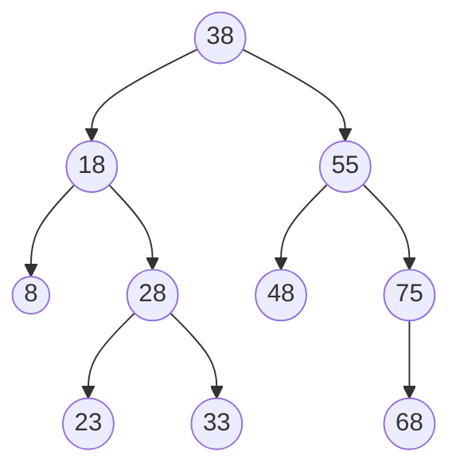

# Estación 2: Recorrido preorden con traza

> **Atiende:** Darwin · **Rama:** `Rama-Joel`
>
> **Para qué:** practicar el recorrido preorden y leer la recursión escribiendo su traza (`entra`, `VISITA` y `null -> regresa`) de un subárbol.

Cada grupo resuelve esta parte en su puesto; Darwin pasa por los grupos ayudando.

## Lista de matrículas

Se insertan en este orden en un árbol binario de búsqueda (ABB):

```
38, 18, 55, 8, 28, 48, 75, 23, 33, 68
```

## Ejercicio

1. Dibuja el ABB que resulta de insertar la lista en ese orden.
2. Escribe la secuencia del recorrido **preorden** de todo el árbol.
3. Escribe la **traza** del preorden del subárbol cuya raíz es **18**: una línea por paso, con 2 espacios de sangría por cada nivel más abajo.
   - `entra <matrícula>` al llegar a un nodo que existe.
   - `VISITA <matrícula>` en el momento en que se visita (en preorden, apenas se entra).
   - `null -> regresa` cuando el hijo no existe (caso base).
   - Al final, la línea `Secuencia PREORDEN: ...`.
4. Responde: ¿cuántas veces aparece `null -> regresa` y por qué?

La respuesta va en la nota del grupo en la columna **Preguntas** del Padlet, en la parte **E2**, junto con la **pregunta 3**: ¿en qué momento se visita el nodo en preorden y en posorden?

## Solución

### 1. El ABB



Raíz 38; hojas 8, 23, 33, 48 y 68; altura 3.

### 2. Preorden de todo el árbol

```
38 18 8 28 23 33 55 48 75 68
```

Se visita el nodo, luego todo el subárbol izquierdo y después el derecho.

### 3. Traza del subárbol de 18

```
entra 18
VISITA 18
  entra 8
  VISITA 8
    null -> regresa
    null -> regresa
  entra 28
  VISITA 28
    entra 23
    VISITA 23
      null -> regresa
      null -> regresa
    entra 33
    VISITA 33
      null -> regresa
      null -> regresa
Secuencia PREORDEN: 18 8 28 23 33
```

Si se ejecuta con el árbol completo (opción 14), esas líneas salen con 2 espacios más de sangría, porque el 18 es hijo del 38.

### 4. Cuántos `null -> regresa`

Aparecen **6**: dos por cada hoja del subárbol (8, 23 y 33). Cada hoja llama a la recursión con su hijo izquierdo y con su derecho, y como ninguno existe, cada llamada termina en el caso base `nodo == null`. Los nodos 18 y 28 tienen sus dos hijos, por eso no generan ninguno.

## Errores frecuentes

- Poner `VISITA` después de las llamadas a los hijos: eso sería posorden.
- Olvidar los dos `null -> regresa` de cada hoja.
- No aumentar la sangría al bajar un nivel.
