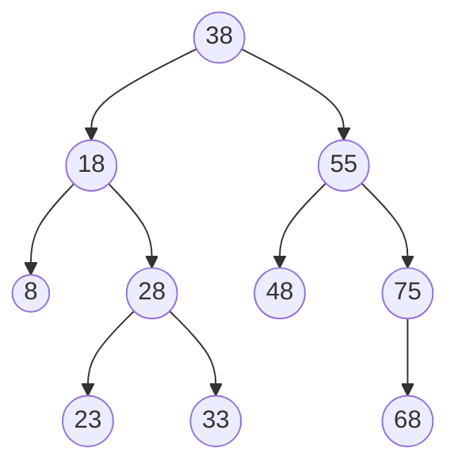

# Estación 3: Inorden y posorden

> **Atiende:** Luis · **Rama:** `Rama-Luis-Silva`
>
> **Para qué:** predecir los recorridos inorden y posorden de un ABB y entender por qué el inorden sale ordenado por matrícula.

Cada grupo resuelve esta parte en su puesto; Luis pasa por los grupos ayudando.

## Lista de matrículas

Se insertan en este orden en un árbol binario de búsqueda (ABB):

```
38, 18, 55, 8, 28, 48, 75, 23, 33, 68
```

## Ejercicio

1. Dibuja el ABB que resulta de insertar la lista en ese orden.
2. Predice, sin ejecutar el programa, la secuencia del recorrido **inorden** y la del **posorden** de todo el árbol.
3. Explica por qué el inorden sale ordenado de menor a mayor.
4. Responde: ¿qué matrícula sale primero y cuál sale al final en el posorden?

La respuesta va en la nota del grupo en la columna **Preguntas** del Padlet, en la parte **E3**, junto con la **pregunta 2**: ¿por qué el recorrido inorden de un ABB sale ordenado?

## Solución

### 1. El ABB



Raíz 38; hojas 8, 23, 33, 48 y 68; altura 3.

Cómo se ubica cada matrícula, comparando desde la raíz (menor a la izquierda, mayor a la derecha):

| Matrícula | Camino | Queda |
|---|---|---|
| 38 | raíz | raíz |
| 18 | 18 < 38 | izquierda de 38 |
| 55 | 55 > 38 | derecha de 38 |
| 8 | 8 < 38, 8 < 18 | izquierda de 18 |
| 28 | 28 < 38, 28 > 18 | derecha de 18 |
| 48 | 48 > 38, 48 < 55 | izquierda de 55 |
| 75 | 75 > 38, 75 > 55 | derecha de 55 |
| 23 | 23 < 38, 23 > 18, 23 < 28 | izquierda de 28 |
| 33 | 33 < 38, 33 > 18, 33 > 28 | derecha de 28 |
| 68 | 68 > 38, 68 > 55, 68 < 75 | izquierda de 75 |

### 2. Recorridos de todo el árbol

**Inorden** (izquierdo, VISITA, derecho):

```
8 18 23 28 33 38 48 55 68 75
```

**Posorden** (izquierdo, derecho, VISITA):

```
8 23 33 28 18 48 68 75 55 38
```

En el posorden cada nodo se visita después de sus dos hijos: primero todo el subárbol izquierdo de 38 (8, 23, 33, 28, 18), luego el derecho (48, 68, 75, 55) y al final la raíz 38.

### 3. Por qué el inorden sale ordenado

En un ABB todo lo que está a la izquierda de un nodo es menor y todo lo que está a la derecha es mayor. El inorden visita primero el subárbol izquierdo, luego el nodo y al final el derecho, así que siempre aparece primero lo menor y después lo mayor. Por eso el resultado queda ordenado por matrícula, sin tener que ordenar nada.

### 4. Primero y último en el posorden

Sale primero el **8**, porque es la hoja más a la izquierda: el posorden baja siempre por la izquierda hasta el caso base antes de visitar algo. Sale al final el **38**, porque la raíz se visita cuando ya terminaron sus dos subárboles.

Para comprobarlo en el programa: opción 10 con INORDEN y POSORDEN, y opción 14 para ver la traza.

## Errores frecuentes

- Confundir el posorden con el inorden: en el posorden la visita va después de los dos hijos, no entre ellos.
- Olvidar que el 28 se visita después de sus hijos 23 y 33 (`23 33 28`), no antes.
- Pensar que el inorden sale ordenado en cualquier árbol: solo ocurre en un ABB.